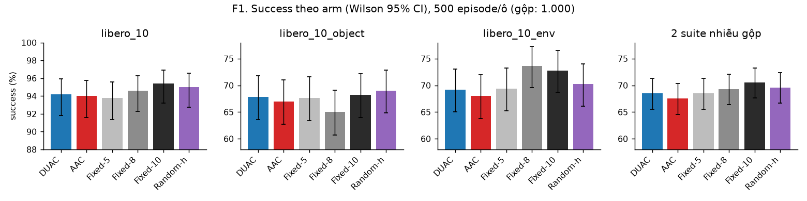
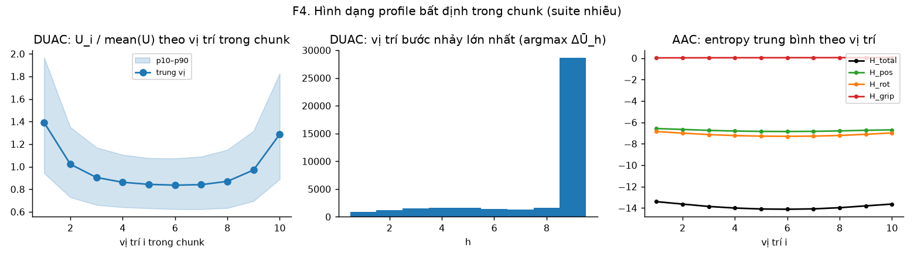
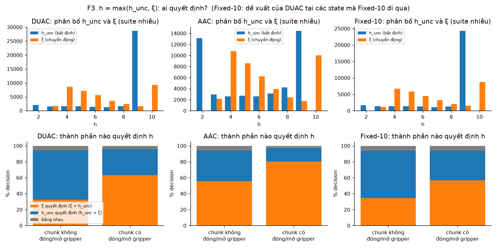
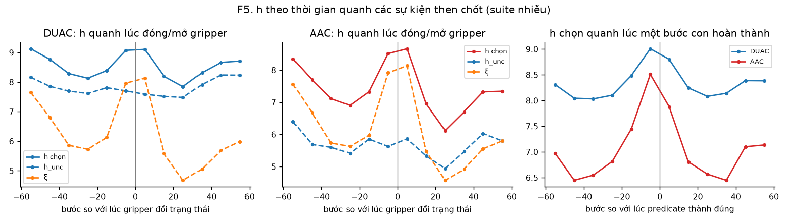
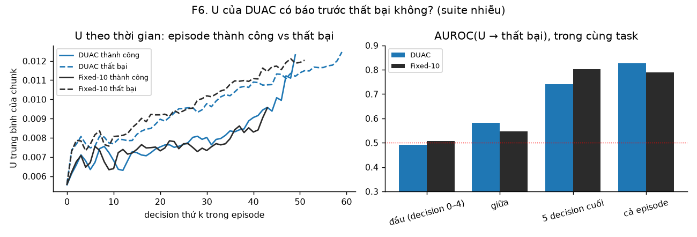
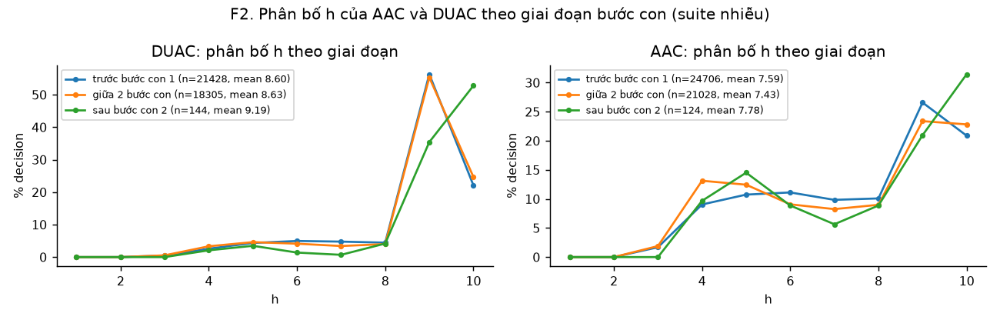
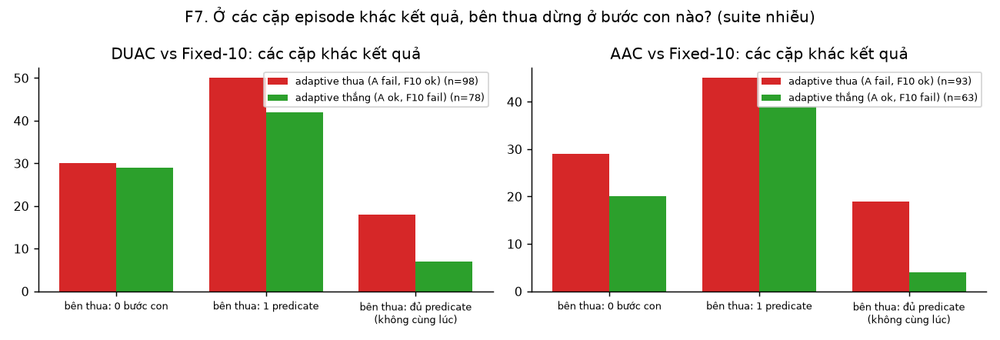
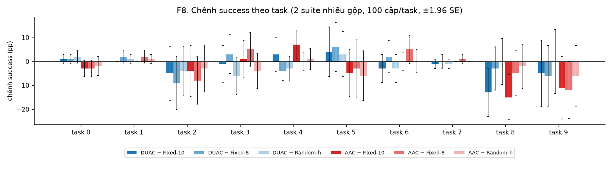

# Vì sao AAC và DUAC không thắng horizon cố định trên LIBERO-10: phân tích từ log thuật toán

Báo cáo này đi kèm [REPORT.md](../REPORT_trackA.md). Dữ liệu là 9.000 episode của Track A (3 suite × 6 arm × 500), với **mọi thông số toán học của từng decision** ghi trong `algo_log.jsonl`. Biểu đồ và số liệu được sinh bằng `analysis/diagnose_track_a.py` (số liệu ở `diagnosis.json`). Trừ khi ghi khác, các con số tính trên 2 suite nhiễu gộp lại (`libero_10_object` + `libero_10_env`, khoảng 40.000 decision mỗi arm).

## 0. Log đang có
| Arm | Thông số ghi ở mỗi decision |
|---|---|
| DUAC | `U` (phương trình 6, 10 vị trí trong chunk), `divergence` (vết Jacobian ước lượng bằng Hutchinson), trung bình tiền tố Ū_h và bước nhảy ΔŪ_h, `h_unc` (phương trình 8), `motion_m` (chuyển động cộng dồn m_h), `xi` (cận dưới chuyển động), `h_duac = max(h_unc, ξ)`, chunk đã chạy |
| AAC | `H_pos`, `H_rot`, `H_grip`, `H_total` (entropy trên 20 sample, theo từng vị trí), Ū_h / ΔŪ_h, `h_entropy`, `motion_m`, `xi`, `h_aac`, tỉ lệ gripper đóng trên 20 sample, độ phân tán vị trí của các sample. State bank lưu đủ 20 sample |
| Fixed-5/8/10, Random-h | Toàn bộ thông số của DUAC: server DUAC tính ở mọi decision dù arm không dùng. Nhờ đó biết được **DUAC lẽ ra đã chọn h nào** tại đúng các state mà Fixed đi qua |

---

## 1. Tóm tắt: 4 nguyên nhân, mỗi nguyên nhân có bằng chứng

| # | Nguyên nhân | Bằng chứng chính | Hình |
|---|---|---|---|
| 1 | **h_unc của DUAC chủ yếu do vị trí trong chunk quyết định, không do state.** Profile U có hình chữ U cố định, nên bước nhảy lớn nhất gần như luôn rơi vào cuối chunk | U₁₀ > U₉ ở **93%** decision. h_unc = 9 ở **72%** decision (76.7% khi U₁₀ > U₉, chỉ 6.4% khi không). Tự tương quan h_unc giữa 2 decision liên tiếp: **−0.04** | F3, F4 |
| 2 | **Ở thời điểm then chốt, h do cận dưới chuyển động ξ quyết định, không do độ bất định.** Quanh lúc đóng/mở gripper, ξ đẩy h lên dài hơn | Chunk có đóng/mở gripper: ξ quyết định h ở **63%** (DUAC) và **80%** (AAC) số decision. h tăng từ khoảng 8.1 lên **9.1** (DUAC), từ 6.9 lên **8.7** (AAC) ngay quanh sự kiện; h_unc gần như phẳng | F3, F5 |
| 3 | **Tín hiệu bất định không báo trước được thất bại.** U chỉ tăng *sau khi* episode đã hỏng | AUROC(U → thất bại) trong cùng task: **0.49** ở 5 decision đầu (bằng đoán ngẫu nhiên), 0.58 ở giữa, 0.74 ở 5 decision cuối. U ở các state Fixed-10 đi qua cũng có AUROC tương tự | F6 |
| 4 | **Không có nơi nào adaptive thắng ổn định.** Các cặp episode khác kết quả phân bố giống nhau ở mọi giai đoạn; chênh theo task là nhiễu | So với Fixed-10: DUAC thua 98 cặp, thắng 78; AAC thua 93, thắng 63. Phân bố giai đoạn thất bại của bên thua giống nhau. Chênh theo task trong ±15 pp, CI cắt qua 0 ở 8/10 task | F7, F8 |

Kết luận: **thứ được gọi là "adaptive" ở đây không mang thông tin về state.** Phân bố h của DUAC được Random-h tái tạo lại gần như y hệt (h trung bình 8.6 so với 8.6), và Random-h đạt kết quả ngang hoặc hơn DUAC (+1.1 pp).

---

## 2. Kết quả tổng (F1)


Fixed-10 cao nhất ở clean (95.4%) và trên 2 suite gộp (70.5%). Mọi khoảng tin cậy chồng lên nhau. Chi tiết thống kê (McNemar, Holm, bootstrap) ở mục T2 của [REPORT.md](../REPORT_trackA.md).

---

## 3. Nguyên nhân 1: h_unc của DUAC là hiệu ứng rìa chunk



**Quan sát** (F4, hình trái). Profile U chia cho trung bình của chính nó có **hình chữ U ổn định**: cao ở vị trí 1 (khoảng 1.39 lần) và vị trí 10 (khoảng 1.29 lần), thấp ở giữa (khoảng 0.84 lần). Băng p10–p90 cũng có cùng hình dạng. Hệ số tương quan trung vị giữa profile của một decision và profile trung vị là 0.71.

**Hệ quả cho phương trình 8.** h_unc = argmax_h (Ū_{h+1} − Ū_h). Vì U₁ lớn nên Ū_h giảm dần ở đầu chunk. Vì U₁₀ lớn nên bước nhảy lớn nhất gần như luôn là từ Ū₉ sang Ū₁₀, tức **h_unc = 9** (F4, hình giữa: 28.617/39.877 decision).

| Bằng chứng | Giá trị |
|---|---|
| U₁₀ > U₉ | 93.0% decision |
| h_unc = 9 khi U₁₀ > U₉ / khi U₁₀ ≤ U₉ | 76.7% / 6.4% |
| h_unc ∈ {9, 10} | 71.8% (DUAC), 71.7% (đề xuất của DUAC tại state của Fixed-10) |
| Tự tương quan h_unc giữa 2 decision liên tiếp | **−0.04** |
| Độ lệch chuẩn của h_unc: giữa các task / trong cùng task | 0.33 / 2.24 |

Nếu h_unc phản ánh state thì 2 decision liên tiếp (2 state rất gần nhau) phải cho h_unc gần nhau, và tự tương quan phải dương rõ. Con số **−0.04** cho thấy phần biến động còn lại của h_unc (khi nó không bằng 9) gần như là **nhiễu của bộ ước lượng**: Hutchinson với K = 40 probe, trên một sample noise. Nó cũng gần như không khác nhau giữa các task.

**AAC có cùng vấn đề.** Profile entropy `H_total` (F4, hình phải) cũng có hình chữ U nhẹ, và `H_grip` ≈ 0 ở hầu hết các vị trí (chỉ 23% decision có H_grip > 0.1). Vì vậy h_entropy có phân bố **hai đỉnh**: 28.7% bằng 2, tức cận dưới nhỏ nhất (khi Ū_h giảm suốt chunk), và 31.5% bằng 9, tức bước nhảy ở cuối. h_entropy gần như chỉ ở một trong hai đầu, rất ít giá trị ở giữa.

**Vì sao profile có hình chữ U?** Đây là suy luận, chưa kiểm chứng. Hai đầu của chunk là nơi action expert ít ràng buộc nhất: vị trí 1 gắn với state hiện tại, vị trí cuối xa nhất về thời gian. Hình chữ U khi đó là đặc tính của model và vị trí trong chunk, không phải của tình huống cụ thể. Dù vì lý do gì, quy tắc "bước nhảy lớn nhất" của phương trình 8 đều nhạy với hình dạng cố định này hơn là với thay đổi theo state.

---

## 4. Nguyên nhân 2: ở thời điểm then chốt, ξ quyết định h, theo hướng ngược với giả thuyết



**F3, hàng dưới: thành phần nào quyết định h = max(h_unc, ξ)?**
| | Chunk không đóng/mở gripper | Chunk **có** đóng/mở gripper |
|---|---|---|
| DUAC: ξ quyết định / h_unc quyết định | 32% / 62% | **63% / 33%** |
| AAC: ξ quyết định / h_unc quyết định | 56% / 38% | **80% / 17%** |
| DUAC: h trung bình (h_unc, ξ) | 8.52 (7.82, 6.29) | **9.36** (7.78, **8.42**) |
| AAC: h trung bình (h_unc, ξ) | 7.35 (5.67, 6.14) | **9.16** (5.75, **8.69**) |



**F5: h theo thời gian quanh lúc gripper đổi trạng thái** (cửa sổ 10 bước, suite nhiễu).
| Bước so với sự kiện | −25 | −15 | **−5** | **+5** | +15 | +25 |
|---|---|---|---|---|---|---|
| DUAC: h chọn | 8.13 | 8.39 | **9.07** | **9.11** | 8.20 | 7.85 |
| DUAC: ξ | 5.72 | 6.13 | **7.96** | **8.13** | 5.58 | 4.67 |
| DUAC: h_unc | 7.61 | 7.81 | 7.70 | 7.59 | 7.52 | 7.48 |
| AAC: h chọn | 6.90 | 7.33 | **8.51** | **8.66** | 6.96 | 6.12 |
| AAC: ξ | 5.63 | 5.97 | **7.91** | **8.13** | 5.48 | 4.57 |
| AAC: h_entropy | 5.42 | 5.85 | 5.63 | 5.86 | 5.33 | 4.94 |

- **h_unc và h_entropy phẳng.** Thành phần bất định không phản ứng gì với sự kiện gắp hay nhả, trong khi đó là lúc giả thuyết O-LONG cho rằng cần replan sớm.
- **ξ tăng vọt từ khoảng 5.7 lên khoảng 8.1** ngay quanh sự kiện, kéo h lên dài hơn. Lý do: khi gắp, tay robot gần như đứng yên, nên chuyển động cộng dồn m_h khó vượt α = 3. Theo định nghĩa của ξ, cần nhiều bước hơn mới vượt ngưỡng, nên ξ tăng.
- **Kết quả: ngay lúc robot gắp, cả hai thuật toán đều replan chậm hơn bình thường.** Fixed-5 replan đều đặn ở mọi lúc. Fixed-10 thì vốn đã chạy hết chunk.
- **Quanh lúc một bước con hoàn thành** (F5, hình phải), h cũng tăng lên (DUAC 8.0 → 9.0, AAC 6.5 → 8.5). Nguyên nhân giống nhau: khi đặt vật, robot cũng chậm lại.

---

## 5. Nguyên nhân 3: U không báo trước thất bại



- **F6, hình trái:** ở 10–15 decision đầu, U của episode thành công và thất bại **trùng nhau**. Hai đường chỉ tách ra sau đó, khi episode thất bại đã kẹt ở trạng thái lạ: U của chúng tăng dần đến hết 520 bước.
- **F6, hình phải:** AUROC dự đoán thất bại từ U, so trong cùng task để loại bỏ khác biệt giữa các task.

| Cửa sổ | DUAC | U tại state của Fixed-10 |
|---|---|---|
| 5 decision đầu | **0.49** | 0.51 |
| decision 10–19 | 0.58 | 0.55 |
| 5 decision cuối | 0.74 | 0.80 |
| cả episode | 0.83 | 0.79 |

AUROC 0.8 "cả episode" chỉ là ảo giác: nó đến từ phần đuôi, sau khi đã thất bại. Ở thời điểm còn cứu được, U không phân biệt được episode sẽ thành công hay thất bại. Một tín hiệu không báo trước được rủi ro thì không thể dùng để chọn h nhằm tránh thất bại. Điều này giải thích vì sao DUAC không cứu được episode nào so với horizon cố định.

---

## 6. Nguyên nhân 4: không có giai đoạn hay task nào adaptive thắng ổn định



**F2:** phân bố h gần như **trùng nhau** ở các giai đoạn trước bước con 1, giữa 2 bước con và sau bước con 2.
- DUAC: trung bình 8.60 / 8.63 / 9.19. Giai đoạn cuối chỉ có 144 decision, vì episode kết thúc ngay khi xong.
- AAC: 7.59 / 7.43 / 7.78.

Thuật toán không phân biệt được giai đoạn gắp vật thứ nhất với giai đoạn gắp vật thứ hai.



**F7: các cặp episode cùng (task, trial) nhưng khác kết quả so với Fixed-10.** Mỗi ô ghi số cặp theo bước con mà bên thua dừng lại.
| | Bên thua: 0 bước con | 1 predicate | đủ predicate nhưng không cùng lúc | Tổng |
|---|---|---|---|---|
| DUAC thua (DUAC fail, Fixed-10 ok) | 30 | 50 | 18 | **98** |
| DUAC thắng (DUAC ok, Fixed-10 fail) | 29 | 42 | 7 | **78** |
| AAC thua | 29 | 45 | 19 | **93** |
| AAC thắng | 20 | 39 | 4 | **63** |

- Trận thua và trận thắng có cùng phân bố giai đoạn. Không có giai đoạn nào mà adaptive giỏi hơn một cách hệ thống.
- Nhóm "đủ predicate nhưng không cùng lúc" là trường hợp vật đã đặt đúng chỗ rồi bị xô lệch hoặc rơi ra. Adaptive thua ở nhóm này nhiều hơn rõ (18–19 so với 4–7). Đây là gợi ý cần xem video: có thể việc chạy chunk dài hơn đúng lúc đặt vật (nguyên nhân 2) làm robot va vào vật đã đặt.



**F8:** chênh lệch theo task dao động trong ±15 pp, và khoảng tin cậy cắt qua 0 ở hầu hết các task.
- Chỗ kém rõ nhất là **task 8** (*put both moka pots on the stove*, trên `env`): AAC −15 pp, DUAC −13 pp so với Fixed-10.
- Tiếp theo là **task 9** (*mug vào microwave rồi đóng cửa*): AAC −11 pp.
- Cả hai đều là task cần thao tác chính xác ở bước con thứ hai.

---

## 7. Kiểm chứng thêm: các arm đối chứng loại trừ những cách giải thích khác
- **Random-h** dùng đúng phân phối h của DUAC (cùng suite, cùng task) nhưng rút ngẫu nhiên. Kết quả 69.6%, so với DUAC 68.5%. Nếu việc DUAC chọn h theo state có giá trị thì DUAC phải hơn Random-h; thực tế không hơn.
- **Fixed-8** có h trung bình gần bằng DUAC (8 so với 8.6) và đạt 69.3%. Như vậy mức h trung bình cũng không giải thích được chênh lệch.
- **Đề xuất của DUAC tại các state mà Fixed-10 đi qua** (log của arm Fixed-10) có phân bố giống hệt lúc chạy DUAC thật: h_unc = 9 ở 71.7% so với 71.8%; ξ quyết định 57% so với 63% ở chunk có gripper. Hành vi mô tả ở các mục trên là **tính chất của thuật toán**, không phải do DUAC tự đưa robot vào những state đặc biệt.

---

## 8. Hệ quả và gợi ý (thí nghiệm riêng, không chỉnh trên dữ liệu chạy chính)
1. **Phương trình 8 cần loại bỏ hiệu ứng rìa chunk.** Ví dụ: chuẩn hoá U theo profile trung bình của từng vị trí (tính trên dữ liệu calibration), hoặc bỏ U₁ và U_H trước khi tính bước nhảy. Sau đó kiểm lại xem tự tương quan của h_unc có tăng không, và AUROC ở giai đoạn đầu có lên trên 0.5 không.
2. **ξ đang ngược với mục tiêu.** Có thể thử:
   - α nhỏ hơn,
   - bỏ hẳn ξ (dùng thuần phương trình 8),
   - khi chunk có đổi trạng thái gripper, cắt h ngay trước điểm đổi.

   Rồi đo xem các trận thua ở nhóm "vật đã đặt rồi bị xô lệch" có giảm không.
3. **Phải có tín hiệu báo trước được thất bại.** Khi AUROC ở giai đoạn đầu ≈ 0.5, không cách chọn h nào dựa trên tín hiệu đó vượt được horizon cố định. Thí nghiệm phản thực từ state bank (rẽ nhánh replan sớm so với muộn tại cùng một state) sẽ đo trực tiếp *lợi ích tối đa* có thể đạt được, trước khi tìm tín hiệu tốt hơn.
4. **RoboCasa** (chunk 50, h của DUAC từ 4 đến 49) nên kiểm cùng các đại lượng này trước: hình dạng profile U, tự tương quan của h_unc, AUROC ở giai đoạn đầu.

---

### Tái lập
```bash
.venv-libero/bin/python analysis/diagnose_track_a.py      # hình F1–F8 + diagnosis.json
.venv-libero/bin/python analysis/track_a_results.py       # T1–T3 + tiêu chí mục 5
```
