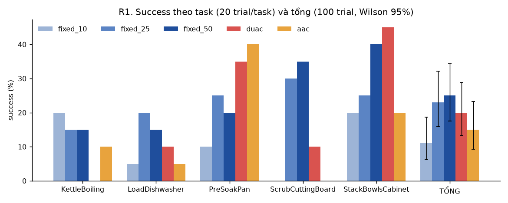
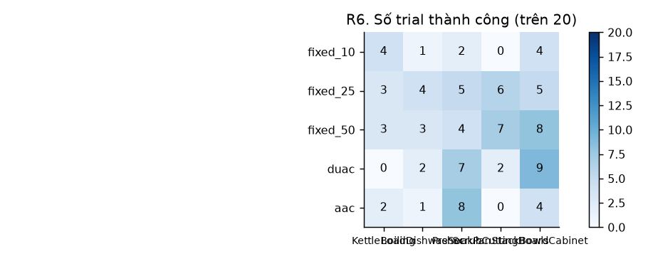
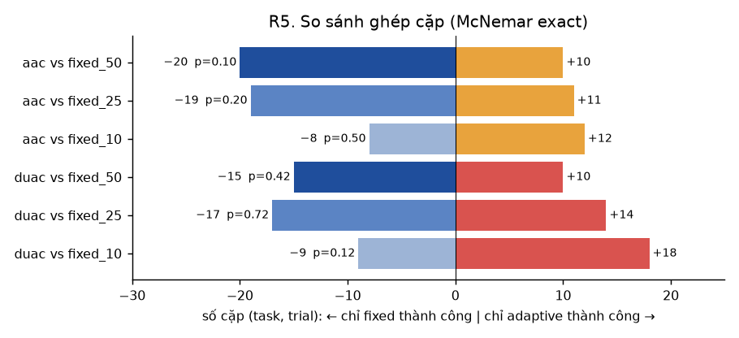
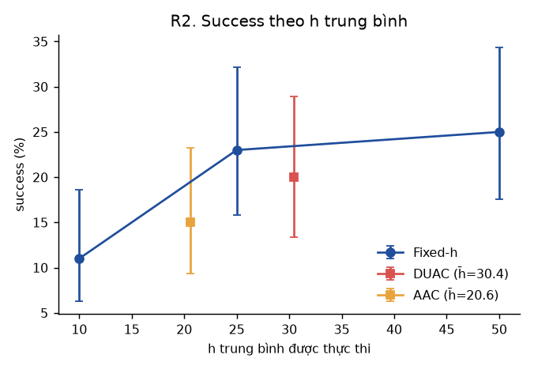
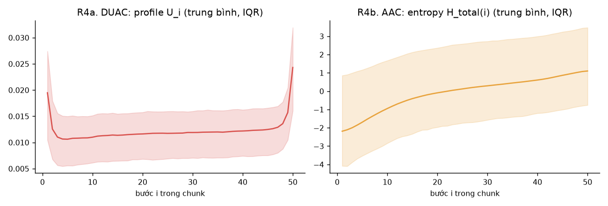
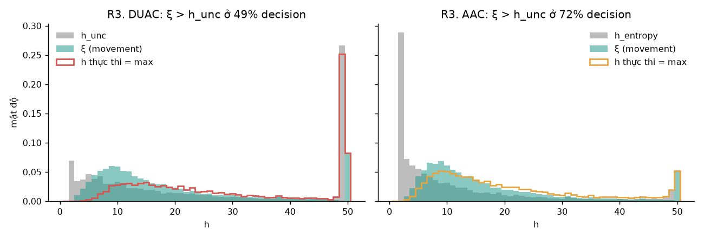
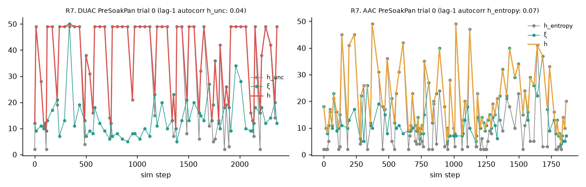
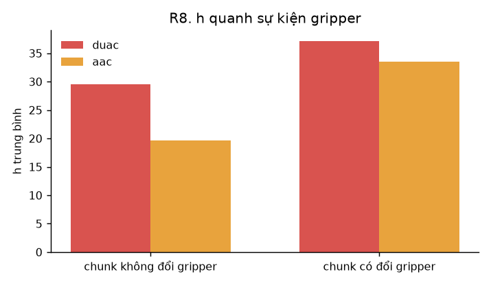

# Báo cáo RoboCasa365: AAC và DUAC so với fixed horizon (π0.5, chunk 50)

**Câu hỏi.** Trên các task composite dài của RoboCasa365, chọn độ dài chunk một cách thích nghi (AAC, DUAC) có tốt hơn horizon cố định tốt nhất không?

**Kết luận ngắn.**
- **Chưa có arm thích nghi nào tốt hơn fixed horizon.** DUAC đạt 20%, AAC 15%, còn Fixed-50 là 25% và Fixed-25 là 23%.
- **Không so sánh nào có ý nghĩa thống kê.** Sau hiệu chỉnh Holm, mọi p ≥ 0.59. Theo tiêu chí của Track A, cả hai đều **INCONCLUSIVE**: CI 95% của chênh lệch so với Fixed-50 chứa 0, và cận trên chỉ khoảng +5 pp (DUAC) và 0 pp (AAC).
- **Điều chắc chắn duy nhất là h ngắn thì kém.** Fixed-10 chỉ đạt 11%.
- **AAC và DUAC đều lặp lại 2 lỗi đã thấy ở LIBERO.** Thứ nhất, phần độ bất định cho ra h nằm ở 2 đầu chunk. Thứ hai, ngưỡng chuyển động ξ quyết định h phần lớn thời gian. Hệ quả là h không thích nghi theo task: task nào h trung bình cũng gần như nhau.

---

## 1. Thiết lập

| | |
|---|---|
| Policy | `lerobot/pi05_robocasa` (rev `3206f645`), PyTorch. Chunk H = 50, action 12 chiều, 3 camera 256×256 |
| Task | 5 task `composite_seen`: `KettleBoiling`, `LoadDishwasher`, `PreSoakPan`, `ScrubCuttingBoard`, `StackBowlsCabinet`. Đây là các task có success > 0 ở bước smoke (16 task × 2 trial) |
| Trial | 20 trial/task, seed của trial k là k. Mọi arm dùng cùng seed nên các episode ghép cặp được theo (task, trial) |
| Arm | Fixed-10, Fixed-25, Fixed-50, DUAC (τ = 0.9, K = 40 probe Rademacher), AAC (N = 20 sample, selector `gaussian_bernoulli` chính thức). Mỗi arm 100 episode, tổng cộng 500 |
| Cả hai thuật toán | h = max(h_unc, ξ). ξ là ngưỡng chuyển động chính thức của AAC (α = 3) |
| Độ dài episode | Bằng horizon của task trong registry RoboCasa (khoảng 1.500–2.400 bước) |
| Thời gian chạy | 2026-11-05 20:56 tới 2026-11-06 07:15, 1 GPU RTX 5090, 10 client mô phỏng song song. Không job nào lỗi |

Code: `flowbased_aac/flowbased_aac/robocasa/`. Job: `jobs/robocasa_main_{duac,aac}.txt`. Thống kê và hình: `analysis/robocasa_report.py`.

---

## 2. Kết quả chính

### 2.1 Success

| task | Fixed-10 | Fixed-25 | Fixed-50 | DUAC | AAC |
|---|---|---|---|---|---|
| KettleBoiling | **4**/20 | 3/20 | 3/20 | 0/20 | 2/20 |
| LoadDishwasher | 1/20 | **4**/20 | 3/20 | 2/20 | 1/20 |
| PreSoakPan | 2/20 | 5/20 | 4/20 | 7/20 | **8**/20 |
| ScrubCuttingBoard | 0/20 | 6/20 | **7**/20 | 2/20 | 0/20 |
| StackBowlsCabinet | 4/20 | 5/20 | 8/20 | **9**/20 | 4/20 |
| **Tổng** | 11% [6–19] | 23% [16–32] | **25% [18–34]** | 20% [13–29] | 15% [9–23] |

Trong ngoặc vuông là Wilson CI 95%. Nếu chọn horizon tốt nhất riêng cho từng task (chọn sau khi đã biết kết quả), Fixed đạt 28%. Đây là cận trên của mọi cách chọn horizon cố định.

### 2.2 So sánh ghép cặp

Mỗi cặp là cùng một (task, trial) chạy bằng 2 arm. "Chỉ A thành công" đếm số cặp mà A thành công còn B thì không.

| so sánh | chênh lệch | CI 95% (bootstrap theo task) | chỉ adaptive thành công | chỉ fixed thành công | p McNemar | p Holm |
|---|---|---|---|---|---|---|
| DUAC vs Fixed-10 | +9 pp | [+1, +17] | 18 | 9 | 0.12 | 0.61 |
| DUAC vs Fixed-25 | −3 pp | [−13, +7] | 14 | 17 | 0.72 | 1.00 |
| DUAC vs Fixed-50 | −5 pp | [−15, +5] | 10 | 15 | 0.42 | 1.00 |
| AAC vs Fixed-10 | +4 pp | [−4, +12] | 12 | 8 | 0.50 | 1.00 |
| AAC vs Fixed-25 | −8 pp | [−18, +2] | 11 | 19 | 0.20 | 0.80 |
| AAC vs Fixed-50 | −10 pp | [−20, 0] | 10 | 20 | 0.10 | 0.59 |

**Đọc bảng:**
- DUAC chỉ hơn Fixed-10, và CI lệch dương nhưng không qua được hiệu chỉnh Holm.
- So với Fixed-25 và Fixed-50, cả DUAC và AAC đều kém hơn về điểm ước lượng.
- AAC kém Fixed-50 tới 10 pp, sát ngưỡng có ý nghĩa: CI chạm 0, p = 0.10.

**Cỡ mẫu.** Khoảng 27% cặp cho kết quả khác nhau giữa 2 arm. Với tỉ lệ đó, muốn phát hiện chênh lệch thật +5 pp (power 80%, α = 0.05) cần khoảng **850 cặp mỗi arm**, tức gấp 8.5 lần hiện tại. Vì vậy chênh lệch dưới khoảng 10 pp không phân biệt được ở thí nghiệm này.

### 2.3 Success theo h trung bình

- Với fixed horizon, success tăng mạnh từ h = 10 lên h = 25, sau đó gần như đi ngang tới h = 50.
- DUAC (h trung bình 30.4) và AAC (h trung bình 20.6) đều nằm **dưới** đường fixed khi so cùng h trung bình. Nói cách khác, cách phân bổ h theo từng decision không mang lại gì hơn việc dùng một h cố định có cùng trung bình.

### 2.4 Chi phí

| | Fixed-10 | Fixed-25 | Fixed-50 | DUAC | AAC |
|---|---|---|---|---|---|
| Số decision mỗi episode | 177 | 67 | 33 | 56 | 84 |
| Thời gian infer mỗi decision | 229 ms | 228 ms | 229 ms | 229 ms | 290 ms |
| Số bước tới khi thành công (trung bình) | 1600 | 1294 | **1200** | 1562 | 1609 |
| Thời gian mỗi episode | 6.0 phút | 5.3 phút | 4.9 phút | 5.2 phút | 5.6 phút |

- Fixed-50 vừa có success cao nhất vừa xong task nhanh nhất.
- DUAC gần như không tốn thêm thời gian so với fixed, nhờ phép ước lượng Hutchinson được xử lý chung trong một batch.
- AAC chậm hơn khoảng 27% mỗi decision vì phải lấy 20 sample.

---

## 3. Vì sao chưa thắng: phân tích cách chọn h

### 3.1 DUAC: hiệu ứng biên ở 2 đầu chunk

**Profile U_i có hình chữ U** (R4a). U cao ở bước 1, phẳng ở giữa chunk, rồi tăng vọt ở 3 bước cuối:
- U trung bình ở bước 1, 2, 3 là 0.0195, 0.0126, 0.0110.
- U trung bình ở bước 48, 49, 50 là 0.0136, 0.0157, 0.0243.
- U₅₀ > U₄₉ ở **96%** decision.

**Hệ quả:** quy tắc "bước nhảy lớn nhất của trung bình tiền tố" (phương trình 8) chủ yếu bắt được 2 cạnh này, chứ không phải điểm độ bất định tăng thật trong chunk:
- **h_unc = 49 ở 27% decision**, đây là giá trị hay gặp nhất.
- h_unc ≤ 3 ở 10% decision.
- Tổng cộng 33% decision thực thi gần hết chunk (h ≥ 49).

Đây đúng là hiện tượng đã thấy ở LIBERO (chunk 10, h_unc = 9 ở 72% decision), nên không phải đặc thù của LIBERO.

### 3.2 AAC: entropy tăng đơn điệu, nên phần độ bất định gần như luôn chọn h tối thiểu

Profile H_total(i) tăng đều suốt chunk (R4b), không có điểm gãy nào. Vì vậy bước nhảy lớn nhất thường rơi ngay ở đầu chunk:
- **h_entropy = 2 ở 29% decision.**
- h_entropy ≤ 3 ở 36% decision.
- Trung vị h_entropy chỉ là 6.

Lúc đó h thực chất do ξ quyết định.

### 3.3 ξ quyết định h phần lớn thời gian

| | ξ > h_unc (ξ quyết định) | h_unc ≥ 48 | h_unc ≤ 3 | h trung bình (trung vị) |
|---|---|---|---|---|
| DUAC | **49%** | 27% | 10% | 30.4 (27) |
| AAC | **72%** | 3% | 36% | 20.6 (16) |

- Với DUAC, h là hỗn hợp của 2 nguồn: cạnh cuối chunk (h = 49–50) và ξ (khoảng 8–20).
- Với AAC, h chủ yếu là ξ. Tức AAC trên RoboCasa gần như là "chọn chunk theo ngưỡng chuyển động", và phần entropy đóng góp rất ít.

### 3.4 h không thích nghi theo task

| task | horizon fixed tốt nhất | DUAC: h trung bình | AAC: h trung bình |
|---|---|---|---|
| KettleBoiling | 10 | 30.0 | 24.7 |
| LoadDishwasher | 25 | 28.0 | 17.1 |
| PreSoakPan | 25 | 31.3 | 19.0 |
| ScrubCuttingBoard | 50 | 31.0 | 23.8 |
| StackBowlsCabinet | 50 | 32.0 | 22.2 |

- Horizon tốt nhất của từng task trải từ 10 tới 50, nhưng h trung bình của DUAC chỉ dao động 28–32, còn AAC 17–25.
- **Hai lần thua nặng nhất rơi đúng vào các task mà h cần ở cực trị:**
  - `ScrubCuttingBoard` cần h dài. Fixed-50 đạt 7/20, trong khi DUAC chỉ 2/20 và AAC 0/20.
  - `KettleBoiling` thì Fixed-10 tốt nhất (4/20), trong khi DUAC đạt 0/20.
- Ngược lại, ở `PreSoakPan` và `StackBowlsCabinet`, nơi h trung gian không bị phạt, DUAC (7 và 9) và AAC (8 ở PreSoakPan) cao hơn mọi arm fixed. Tuy vậy, mỗi task chỉ có 20 trial, nên chênh lệch ở mức từng task chỉ là dấu hiệu chứ không phải bằng chứng.

### 3.5 Tín hiệu độ bất định không ổn định giữa các decision

- Tương quan giữa h_unc của 2 decision liên tiếp gần bằng 0: **0.04** với DUAC và **0.07** với AAC (giá trị h_entropy).
- Trong một episode, h_unc nhảy qua lại giữa khoảng 2 và 49 mà không bám theo pha nào của task, nên trông giống nhiễu hơn là tín hiệu (R7).

### 3.6 Độ bất định không dự báo được episode thất bại

AUROC dùng độ bất định trung bình của 10 decision đầu tiên để dự đoán episode thất bại:

| | AUROC (5 task gộp) | AUROC từng task |
|---|---|---|
| DUAC | **0.49** | 0.11 – 0.71 |
| AAC | **0.48** | 0.26 – 0.91 |

- Khi gộp các task, AUROC ở mức ngẫu nhiên (0.5).
- Giá trị ở từng task dao động rất rộng vì mỗi task chỉ có 0–9 episode thành công.
- Ở LIBERO cũng vậy (AUROC 0.49).

### 3.7 h quanh sự kiện đóng/mở gripper

- Các chunk có đổi trạng thái gripper có h lớn hơn: DUAC 37 so với 30, AAC 33 so với 20.
- **Lưu ý:** chunk càng dài thì càng dễ chứa một lần đổi gripper. Vì vậy đây chủ yếu là hiệu ứng chọn mẫu, không chứng minh được thuật toán "chậm lại" quanh lúc gắp.
- Ở các chunk này, ξ quyết định h ít hơn: DUAC 40% so với 50%, AAC 63% so với 73%.

---

## 4. So sánh với Track A (LIBERO, chunk 10)

| | LIBERO (Track A, 9.000 episode) | RoboCasa (500 episode) |
|---|---|---|
| Fixed tốt nhất | Fixed-10 (= H) | Fixed-50 (= H), Fixed-25 gần bằng |
| DUAC so với fixed tốt nhất | −2 pp, không có ý nghĩa | −5 pp, không có ý nghĩa |
| AAC so với fixed tốt nhất | −3 pp, không có ý nghĩa | −10 pp, p = 0.10 |
| Hiệu ứng biên của h_unc | h_unc = 9 ở 72% decision | h_unc = 49 ở 27% (DUAC); h_entropy = 2 ở 29% (AAC) |
| ξ quyết định h | 63–80% quanh sự kiện gripper | 49% (DUAC), 72% (AAC) |
| Tương quan h_unc giữa 2 decision liên tiếp | −0.04 | 0.04 / 0.07 |
| AUROC dự báo thất bại | 0.49 | 0.49 / 0.48 |

Trên 2 benchmark, 2 robot và 2 độ dài chunk (10 và 50), các lỗi đều giống nhau. Điều này cho thấy vấn đề nằm ở **quy tắc chọn h**, cụ thể là phép prefix-mean jump với profile có cạnh và phép max với ξ. Nó không nằm ở việc cài đặt sai cho từng benchmark: công thức U đã được kiểm lại bằng field tuyến tính trong `selftest.py`.

---

## 5. Hạn chế

- **Chỉ có 5 task, mỗi task 20 trial.** Chênh lệch dưới khoảng 10 pp không phân biệt được (mục 2.2). Muốn kết luận chắc thì cần khoảng 850 cặp mỗi arm.
- **5 task được chọn theo kết quả smoke** (task có success > 0), nên đây không phải mẫu đại diện cho RoboCasa365.
- **α = 3 lấy theo LIBERO, chưa chọn lại cho chunk 50.** Ngoài ra chưa có ablation tắt ξ, nên chưa tách được đóng góp riêng của phần độ bất định.
- **Mức success nền của π0.5 trên các task này thấp** (11–25%). Một phần lớn thất bại có thể do policy chứ không do cách chọn chunk.
- **Chưa có Random-h.** Đây là baseline có cùng phân bố h nhưng không dùng thông tin độ bất định.

## 6. Hướng tiếp theo, nếu muốn tiếp tục RoboCasa

1. **Ablation h = h_unc, không có ξ, cho DUAC và AAC,** cùng một baseline Random-h có cùng phân bố h. Đây là cách trực tiếp nhất để biết phần độ bất định có mang thông tin hay không.
2. **Sửa hiệu ứng biên:** bỏ 2–3 bước ở mỗi đầu chunk trước khi tìm bước nhảy, hoặc thay bằng ngưỡng tuyệt đối trên U. Việc này phải ghi vào `manifest.json` *trước khi chạy*, vì đây là thay đổi phương pháp.
3. **Tăng cỡ mẫu,** chỉ nên làm nếu 1–2 cho tín hiệu: khoảng 50 trial/task và thêm task.

---

## Dữ liệu

| | Ở đâu |
|---|---|
| `episodes.csv`, `decisions.csv`, `summary.json`, `args.json` của mỗi `<arm>/<task>` | Thư mục này |
| `analysis/report.json` (toàn bộ số liệu của báo cáo), `analysis/figures/R1–R8.png`, `SUMMARY.md` | Thư mục này |
| `algo_log.jsonl` (profile U / entropy 50 bước, ξ, h_unc ở mỗi decision), `state_bank/*.npz`, `videos/` | Server 3, `/mnt/ceph-cold-storage/hieudd/o_long/aac-duac/robocasa/main/` |

Tạo lại toàn bộ báo cáo: `.venv-robocasa/bin/python analysis/robocasa_report.py outputs/robocasa/main outputs/robocasa/main/analysis`.
