# Báo cáo VLABench: AAC và DUAC so với fixed horizon (π0.5 `VLABench/pi05-primitive-10task`, chunk 10)

*Tự sinh bởi `analysis/vlabench_report.py`; số liệu đọc từ `outputs/vlabench/full`.*

## 1. Thiết lập

| | |
|---|---|
| Policy | `VLABench/pi05-primitive-10task` (OpenPI JAX, bf16). Chunk H = 10, action 7 chiều (pose tuyệt đối + gripper), 3 camera 480×480 → 224 |
| Task | 10 primitive task (T3 thay `select_poker`/`select_mahjong` bằng `select_nth_largest_poker`/`select_unique_type_mahjong`) |
| Track | T1 `track_1_in_distribution`, T2 `track_2_cross_category`, T3 `track_3_common_sense`, T4 `track_4_semantic_instruction`, T6 `track_6_unseen_texture` |
| Episode | Episode 0..N−1 của config track chính thức. Mọi arm cùng episode nên ghép cặp được theo (task, episode) |
| Arm | vanilla (h = 5, cấu hình chính thức), Fixed-8, Fixed-10, DUAC (τ = 0.9, K = 40), AAC (N = 20, `gaussian_bernoulli`). DUAC và AAC: h = max(h_unc, ξ), α = 3 (ξ theo đơn vị LIBERO) |
| Độ dài episode | Chính thức: add_condiment 300, select_poker/select_painting 100, còn lại 200 bước (10 Hz) |
| Phần cứng | 1 GPU RTX 5090. Chạy tuần tự từng track, mỗi lúc một server (vanilla; DUAC, cũng phục vụ Fixed-8/10 như LIBERO/RoboCasa; AAC); 8 client (+6 ở pipeline thứ hai) |

## 2. Tổng hợp theo track

| track | official (vanilla) | vanilla | fixed_8 | fixed_10 | duac | aac | duac_noxi | aac_noxi | random_h |
|---|---|---|---|---|---|---|---|---|---|
| T1 | 40.5% | 42.2% (211/500) | 38.0% (190/500) | 42.2% (211/500) | 38.4% (192/500) | 41.8% (209/500) | 39.4% (197/500) | 25.2% (126/500) | 42.8% (214/500) |
| T2 | 20.7% | 20.7% (95/460) | 26.5% (122/460) | 21.5% (99/460) | 21.7% (100/460) | 21.7% (100/460) | 23.9% (110/460) | 14.3% (66/460) | 22.0% (101/460) |
| T3 | 18.0% | 14.8% (74/500) | 23.2% (116/500) | 20.4% (102/500) | 18.4% (92/500) | 20.8% (104/500) | 20.0% (100/500) | 11.4% (57/500) | 19.0% (95/500) |
| T4 | 15.8% | 14.6% (73/500) | 15.8% (79/500) | 17.4% (87/500) | 15.6% (78/500) | 16.6% (83/500) | 14.2% (71/500) | 13.4% (67/500) | 17.8% (89/500) |
| T6 | 26.1% | 21.2% (106/500) | 26.2% (131/500) | 27.6% (138/500) | 27.4% (137/500) | 25.8% (129/500) | 25.4% (127/500) | 17.2% (86/500) | 24.2% (121/500) |
| **gộp** | | **22.7%** [21–24] | **25.9%** [24–28] | **25.9%** [24–28] | **24.3%** [23–26] | **25.4%** [24–27] | **24.6%** [23–26] | **16.3%** [15–18] | **25.2%** [24–27] |

Kết luận so với fixed tốt nhất của từng track:

| track | fixed tốt nhất | DUAC | AAC | DUAC_NOXI | AAC_NOXI | RANDOM_H |
|---|---|---|---|---|---|---|
| T1 | vanilla | INCONCLUSIVE | INCONCLUSIVE | INCONCLUSIVE | NOT WORK (worse) | INCONCLUSIVE |
| T2 | fixed_8 | NOT WORK (worse) | NOT WORK (worse) | INCONCLUSIVE | NOT WORK (worse) | INCONCLUSIVE |
| T3 | fixed_8 | NOT WORK (worse) | INCONCLUSIVE | INCONCLUSIVE | NOT WORK (worse) | INCONCLUSIVE |
| T4 | fixed_10 | INCONCLUSIVE | INCONCLUSIVE | INCONCLUSIVE | INCONCLUSIVE | INCONCLUSIVE |
| T6 | fixed_10 | INCONCLUSIVE | INCONCLUSIVE | INCONCLUSIVE | NOT WORK (worse) | INCONCLUSIVE |

### Gộp cả 5 track: so sánh ghép cặp (2460 cặp/arm; bootstrap phân tầng theo track × task)

| so sánh | chênh lệch | CI 95% | chỉ adaptive thành công | chỉ fixed thành công | p McNemar | p Holm |
|---|---|---|---|---|---|---|
| duac vs vanilla | +1.6 pp | [-0.5, +3.7] | 372 | 332 | 0.142 | 0.708 |
| duac vs fixed_8 | -1.6 pp | [-3.7, +0.6] | 338 | 377 | 0.155 | 0.708 |
| duac vs fixed_10 | -1.5 pp | [-3.5, +0.5] | 329 | 367 | 0.161 | 0.708 |
| aac vs vanilla | +2.7 pp | [+0.6, +4.8] | 377 | 311 | 0.013 | 0.079 |
| aac vs fixed_8 | -0.5 pp | [-2.6, +1.6] | 352 | 365 | 0.654 | 1.000 |
| aac vs fixed_10 | -0.5 pp | [-2.6, +1.6] | 340 | 352 | 0.676 | 1.000 |
| duac_noxi vs vanilla | +1.9 pp | [-0.1, +3.9] | 361 | 315 | 0.083 | 0.417 |
| duac_noxi vs fixed_8 | -1.3 pp | [-3.4, +0.8] | 334 | 367 | 0.227 | 0.907 |
| duac_noxi vs fixed_10 | -1.3 pp | [-3.4, +0.7] | 325 | 357 | 0.235 | 0.907 |
| aac_noxi vs vanilla | -6.4 pp | [-8.4, -4.4] | 236 | 393 | 0.000 | 0.000 |
| aac_noxi vs fixed_8 | -9.6 pp | [-11.7, -7.6] | 219 | 455 | 0.000 | 0.000 |
| aac_noxi vs fixed_10 | -9.6 pp | [-11.6, -7.5] | 243 | 478 | 0.000 | 0.000 |
| random_h vs vanilla | +2.5 pp | [+0.4, +4.5] | 362 | 301 | 0.020 | 0.118 |
| random_h vs fixed_8 | -0.7 pp | [-2.9, +1.3] | 344 | 362 | 0.522 | 1.000 |
| random_h vs fixed_10 | -0.7 pp | [-2.9, +1.3] | 344 | 361 | 0.547 | 1.000 |

### Ablation bỏ ξ và đối chứng Random-h, gộp cả 5 track

| so sánh | chênh lệch | CI 95% | chỉ arm 1 thành công | chỉ arm 2 thành công | p McNemar | p Holm |
|---|---|---|---|---|---|---|
| duac_noxi vs duac | +0.2 pp | [-1.9, +2.4] | 366 | 360 | 0.853 | 1.000 |
| aac_noxi vs aac | -9.1 pp | [-11.0, -7.1] | 228 | 451 | 0.000 | 0.000 |
| duac_noxi vs random_h | -0.6 pp | [-2.7, +1.5] | 343 | 358 | 0.597 | 1.000 |

h̄ / decision mỗi episode (trung bình các track): duac 9.38 / 18.6, aac 8.77 / 19.7, duac_noxi 6.21 / 28.1, aac_noxi 2.94 / 61.2, random_h 6.22 / 27.8

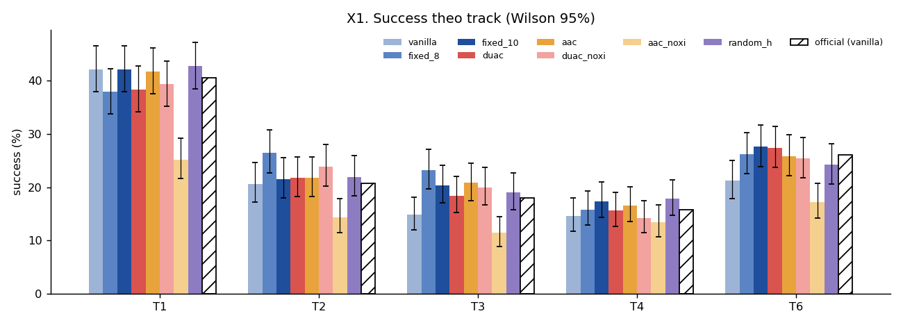 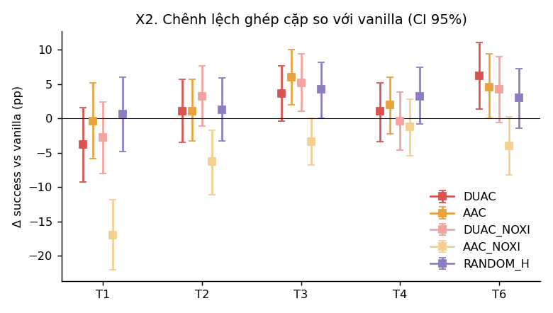

**Chi phí một lần gọi model** (`check_policy.py`, trung vị 20 lần sau warm-up): vanilla 64.9 ms, duac 71.5 ms, aac 86.0 ms (DUAC +6.6 ms, AAC +21.1 ms so với vanilla).

## T1 — `track_1_in_distribution`

500 episode ghép cặp/arm (add_condiment 50, insert_flower 50, select_book 50, select_chemistry_tube 50, select_drink 50, select_fruit 50, select_mahjong 50, select_painting 50, select_poker 50, select_toy 50). Episode lỗi mô phỏng (tính là thất bại): vanilla 4, fixed_8 5, fixed_10 6, duac 8, aac 7, duac_noxi 8, aac_noxi 11, random_h 5.

### T1.1 Success

| task | official (vanilla) | vanilla | fixed_8 | fixed_10 | duac | aac | duac_noxi | aac_noxi | random_h |
|---|---|---|---|---|---|---|---|---|---|
| add_condiment | 0.56 | **33**/50 | 31/50 | 30/50 | 23/50 | 30/50 | 28/50 | 19/50 | **33**/50 |
| insert_flower | 0.22 | 11/50 | 3/50 | 8/50 | **13**/50 | 11/50 | 6/50 | 8/50 | 6/50 |
| select_book | 0.545 | 26/50 | 22/50 | **29**/50 | 24/50 | 25/50 | 20/50 | 12/50 | 27/50 |
| select_chemistry_tube | 0.367 | 26/50 | 20/50 | 24/50 | 25/50 | **30**/50 | 20/50 | 16/50 | 20/50 |
| select_drink | 0.44 | 19/50 | 18/50 | 16/50 | 18/50 | 20/50 | 15/50 | 12/50 | **24**/50 |
| select_fruit | 0.42 | 25/50 | 24/50 | **32**/50 | 29/50 | 25/50 | 23/50 | 12/50 | 22/50 |
| select_mahjong | 0.38 | 17/50 | 13/50 | 15/50 | 12/50 | 17/50 | **21**/50 | 13/50 | 20/50 |
| select_painting | 0.3 | 17/50 | 14/50 | 16/50 | 14/50 | 13/50 | 11/50 | 12/50 | **20**/50 |
| select_poker | 0.52 | 30/50 | 31/50 | 28/50 | 25/50 | 24/50 | **38**/50 | 17/50 | 30/50 |
| select_toy | 0.3 | 7/50 | 14/50 | 13/50 | 9/50 | 14/50 | **15**/50 | 5/50 | 12/50 |
| **Tổng** | 40.5% | **42.2%** [38–47] | **38.0%** [34–42] | **42.2%** [38–47] | **38.4%** [34–43] | **41.8%** [38–46] | **39.4%** [35–44] | **25.2%** [22–29] | **42.8%** [39–47] |
| progress score | | 0.565 | 0.546 | 0.589 | 0.552 | 0.574 | 0.567 | 0.440 | 0.602 |

Fixed tốt nhất: **vanilla**. Chọn fixed tốt nhất riêng từng task (sau khi biết kết quả, cận trên mọi lựa chọn cố định): 45.8%.

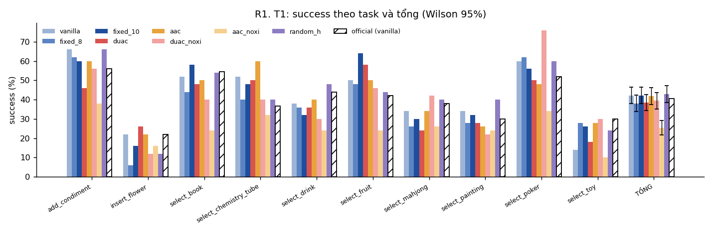

### T1.2 So sánh ghép cặp (cùng task, episode)

| so sánh | chênh lệch | CI 95% (bootstrap theo task) | chỉ adaptive thành công | chỉ fixed thành công | p McNemar | p Holm |
|---|---|---|---|---|---|---|
| duac vs vanilla | -3.8 pp | [-9.2, +1.6] | 89 | 108 | 0.200 | 1.000 |
| duac vs fixed_8 | +0.4 pp | [-4.8, +6.0] | 96 | 94 | 0.942 | 1.000 |
| duac vs fixed_10 | -3.8 pp | [-9.0, +1.6] | 82 | 101 | 0.183 | 1.000 |
| aac vs vanilla | -0.4 pp | [-5.8, +5.2] | 102 | 104 | 0.944 | 1.000 |
| aac vs fixed_8 | +3.8 pp | [-1.8, +9.4] | 110 | 91 | 0.204 | 1.000 |
| aac vs fixed_10 | -0.4 pp | [-5.8, +4.6] | 86 | 88 | 0.940 | 1.000 |
| duac_noxi vs vanilla | -2.8 pp | [-8.0, +2.4] | 84 | 98 | 0.335 | 1.000 |
| duac_noxi vs fixed_8 | +1.4 pp | [-4.0, +6.6] | 94 | 87 | 0.656 | 1.000 |
| duac_noxi vs fixed_10 | -2.8 pp | [-7.8, +2.2] | 77 | 91 | 0.316 | 1.000 |
| aac_noxi vs vanilla | -17.0 pp | [-22.0, -11.8] | 51 | 136 | 0.000 | 0.000 |
| aac_noxi vs fixed_8 | -12.8 pp | [-17.8, -7.6] | 63 | 127 | 0.000 | 0.000 |
| aac_noxi vs fixed_10 | -17.0 pp | [-22.4, -11.4] | 65 | 150 | 0.000 | 0.000 |
| random_h vs vanilla | +0.6 pp | [-4.8, +6.0] | 98 | 95 | 0.886 | 1.000 |
| random_h vs fixed_8 | +4.8 pp | [-0.6, +9.8] | 107 | 83 | 0.095 | 0.570 |
| random_h vs fixed_10 | +0.6 pp | [-4.6, +6.0] | 91 | 88 | 0.881 | 1.000 |

Kết luận so với fixed tốt nhất (vanilla): **DUAC: INCONCLUSIVE**, **AAC: INCONCLUSIVE**, **DUAC_NOXI: INCONCLUSIVE**, **AAC_NOXI: NOT WORK (worse)**, **RANDOM_H: INCONCLUSIVE**.

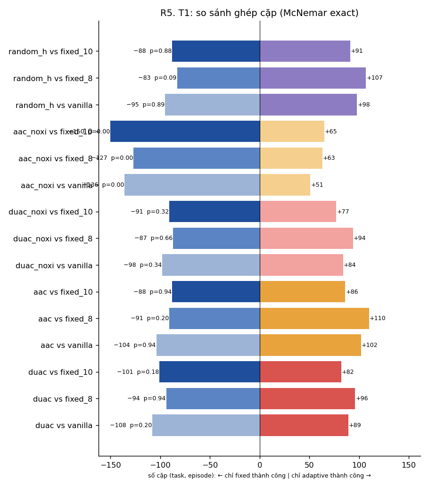 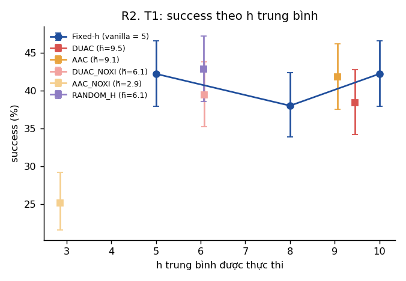

**Ablation bỏ ξ (h = h_unc) so với bản đầy đủ, và so với Random-h cùng phân phối h:**

| so sánh | chênh lệch | CI 95% | chỉ arm 1 thành công | chỉ arm 2 thành công | p McNemar | p Holm |
|---|---|---|---|---|---|---|
| duac_noxi vs duac | +1.0 pp | [-4.6, +6.2] | 104 | 99 | 0.779 | 0.779 |
| aac_noxi vs aac | -16.6 pp | [-21.8, -11.2] | 56 | 139 | 0.000 | 0.000 |
| duac_noxi vs random_h | -3.4 pp | [-8.8, +2.0] | 89 | 106 | 0.252 | 0.504 |

### T1.3 Horizon và chi phí

| arm | h̄ ± sd | decision/episode | bước tới khi thành công | gọi model (ms, đo sạch) | policy ms / action (ước tính) | thời gian/episode |
|---|---|---|---|---|---|---|
| vanilla | 5.00 ± 0.00 | 31.4 | 114 | 64.9 | 13.0 | 23 s |
| fixed_8 | 8.00 ± 0.00 | 19.9 | 109 | 71.5 | 8.9 | 23 s |
| fixed_10 | 10.00 ± 0.00 | 15.7 | 112 | 71.5 | 7.1 | 21 s |
| duac | 9.45 ± 1.35 | 17.4 | 116 | 71.5 | 7.6 | 22 s |
| aac | 9.06 ± 2.04 | 17.4 | 111 | 86.0 | 9.5 | 17 s |
| duac_noxi | 6.09 ± 3.03 | 26.8 | 116 |  |  | 24 s |
| aac_noxi | 2.85 ± 1.93 | 60.4 | 123 |  |  | 47 s |
| random_h | 6.06 ± 3.03 | 26.2 | 113 |  |  | 21 s |

`gọi model` lấy từ `check_policy.py` (một process, sau warm-up, có cả bước tính bất định). Fixed-8/10 chạy trên server DUAC nên mang chi phí của DUAC; nếu chạy bằng server vanilla thì bằng chi phí vanilla. `policy ms / action` = gọi model / h̄.

- **DUAC**: h_unc trung bình 6.43 (trung vị 8; hay gặp nhất [(9, 4229), (2, 1772), (3, 556)]), ξ trung bình 8.89, **ξ = H ở 74.0%**, ξ > h_unc ở 81.8%, h = H ở 74.0%, h_unc ≤ 2 ở 20.4%, h_unc ≥ H−1 ở 48.6%.
- **AAC**: h_unc trung bình 3.14 (trung vị 2; hay gặp nhất [(2, 5987), (3, 682), (9, 574)]), ξ trung bình 8.91, **ξ = H ở 73.9%**, ξ > h_unc ở 91.8%, h = H ở 73.9%, h_unc ≤ 2 ở 68.8%, h_unc ≥ H−1 ở 6.6%.
- **DUAC_NOXI**: h_unc trung bình 6.09 (trung vị 7; hay gặp nhất [(9, 5865), (2, 3397), (3, 925)]), ξ trung bình 9.05, **ξ = H ở 77.5%**, ξ > h_unc ở 85.4%, h = H ở 0.0%, h_unc ≤ 2 ở 25.4%, h_unc ≥ H−1 ở 43.8%.
- **AAC_NOXI**: h_unc trung bình 2.85 (trung vị 2; hay gặp nhất [(2, 23148), (3, 2093), (9, 1663)]), ξ trung bình 8.99, **ξ = H ở 74.5%**, ξ > h_unc ở 92.9%, h = H ở 0.0%, h_unc ≤ 2 ở 76.6%, h_unc ≥ H−1 ở 5.5%.
- **RANDOM_H**: h_unc trung bình 6.48 (trung vị 8; hay gặp nhất [(9, 6390), (2, 2627), (8, 831)]), ξ trung bình 8.96, **ξ = H ở 75.5%**, ξ > h_unc ở 82.7%, h = H ở 0.0%, h_unc ≤ 2 ở 20.0%, h_unc ≥ H−1 ở 48.7%.

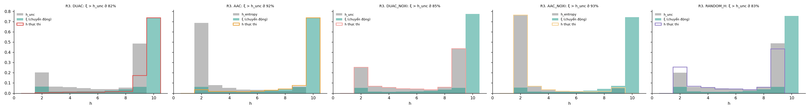 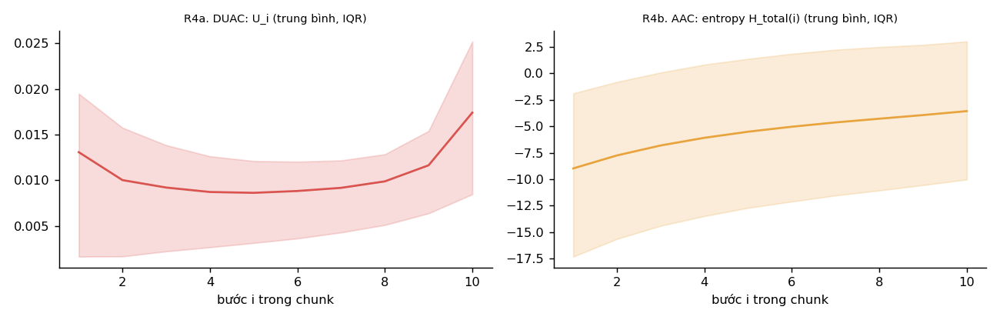

### T1.4 Tín hiệu bất định

- **DUAC**: AUROC (độ bất định trung bình của 10 decision đầu → thất bại) gộp 0.68, trung bình trong task 0.75; lag-1 autocorr h_unc 0.11; h ở chunk đổi gripper 9.7 so với 9.42.
- **AAC**: AUROC (độ bất định trung bình của 10 decision đầu → thất bại) gộp 0.73, trung bình trong task 0.83; lag-1 autocorr h_unc 0.13; h ở chunk đổi gripper 9.6 so với 9.00.
- **DUAC_NOXI**: AUROC (độ bất định trung bình của 10 decision đầu → thất bại) gộp 0.58, trung bình trong task 0.61; lag-1 autocorr h_unc 0.19; h ở chunk đổi gripper 7.68 so với 5.97.
- **AAC_NOXI**: AUROC (độ bất định trung bình của 10 decision đầu → thất bại) gộp 0.55, trung bình trong task 0.54; lag-1 autocorr h_unc 0.18; h ở chunk đổi gripper 6.69 so với 2.76.
- **RANDOM_H**: AUROC (độ bất định trung bình của 10 decision đầu → thất bại) gộp 0.54, trung bình trong task 0.62; lag-1 autocorr h_unc 0.17; h ở chunk đổi gripper 8.01 so với 5.91.

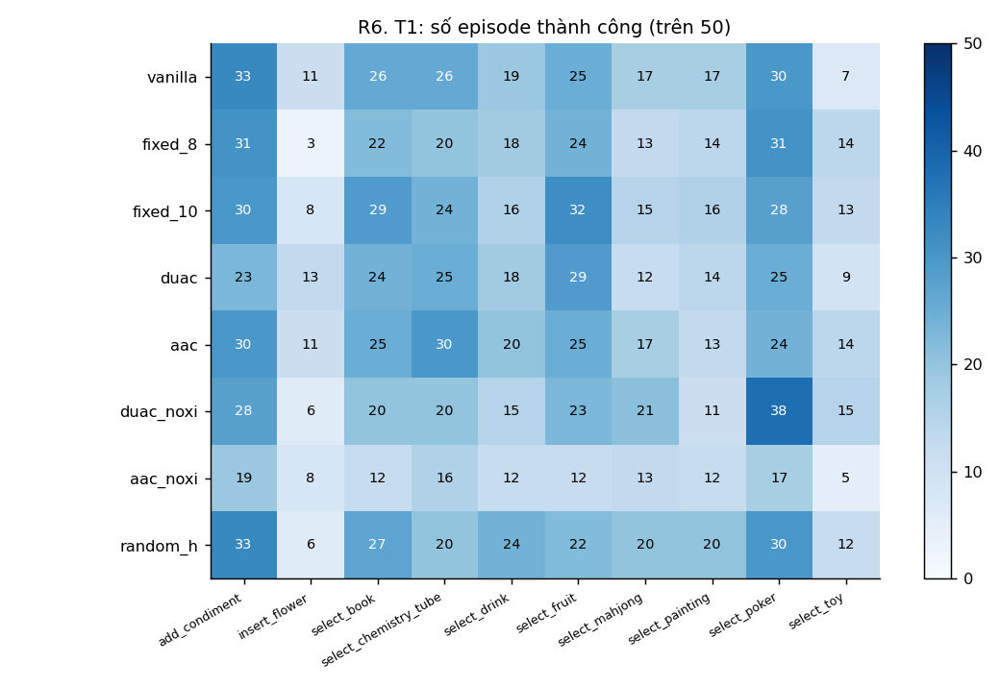 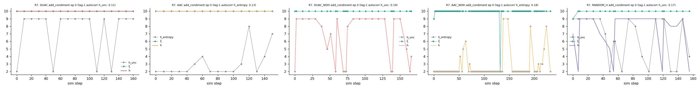 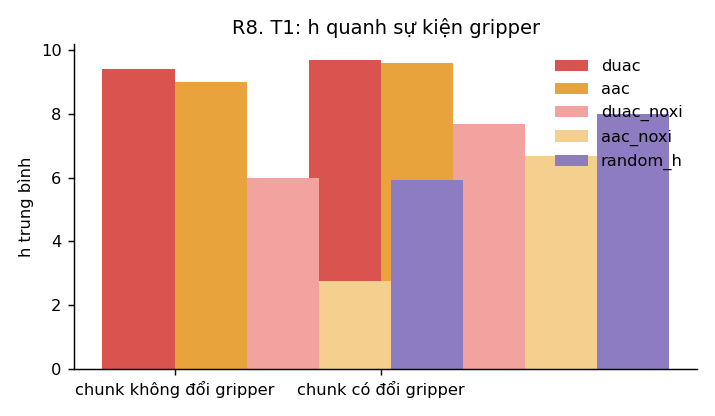

## T2 — `track_2_cross_category`

460 episode ghép cặp/arm (add_condiment 50, insert_flower 10, select_book 50, select_chemistry_tube 50, select_drink 50, select_fruit 50, select_mahjong 50, select_painting 50, select_poker 50, select_toy 50). Episode lỗi mô phỏng (tính là thất bại): vanilla 10, fixed_8 11, fixed_10 9, duac 13, aac 10, duac_noxi 11, aac_noxi 3, random_h 7.

### T2.1 Success

| task | official (vanilla) | vanilla | fixed_8 | fixed_10 | duac | aac | duac_noxi | aac_noxi | random_h |
|---|---|---|---|---|---|---|---|---|---|
| add_condiment | 0.06 | 0/50 | 4/50 | 1/50 | 1/50 | 2/50 | 2/50 | 3/50 | **5**/50 |
| insert_flower | 0.04 | 3/10 | **5**/10 | 2/10 | 2/10 | 4/10 | 4/10 | 3/10 | 3/10 |
| select_book | 0.02 | **5**/50 | 3/50 | 3/50 | 3/50 | 1/50 | 1/50 | 2/50 | 1/50 |
| select_chemistry_tube | 0.16 | 5/50 | **9**/50 | 7/50 | 7/50 | 3/50 | 3/50 | 3/50 | 3/50 |
| select_drink | 0.1 | 4/50 | **10**/50 | 5/50 | 4/50 | 3/50 | 6/50 | 8/50 | 6/50 |
| select_fruit | 0.36 | 19/50 | 22/50 | 23/50 | **27**/50 | 26/50 | 24/50 | 10/50 | 22/50 |
| select_mahjong | 0.27 | 12/50 | 13/50 | 6/50 | 11/50 | 12/50 | **14**/50 | 9/50 | 10/50 |
| select_painting | 0.32 | 16/50 | 17/50 | **18**/50 | 12/50 | 10/50 | 16/50 | 11/50 | 16/50 |
| select_poker | 0.5 | 17/50 | **26**/50 | 24/50 | 22/50 | 25/50 | **26**/50 | 14/50 | 22/50 |
| select_toy | 0.24 | **14**/50 | 13/50 | 10/50 | 11/50 | **14**/50 | **14**/50 | 3/50 | 13/50 |
| **Tổng** | 20.7% | **20.7%** [17–25] | **26.5%** [23–31] | **21.5%** [18–26] | **21.7%** [18–26] | **21.7%** [18–26] | **23.9%** [20–28] | **14.3%** [11–18] | **22.0%** [18–26] |
| progress score | | 0.320 | 0.375 | 0.345 | 0.323 | 0.328 | 0.351 | 0.262 | 0.335 |

Fixed tốt nhất: **fixed_8**. Chọn fixed tốt nhất riêng từng task (sau khi biết kết quả, cận trên mọi lựa chọn cố định): 27.6%.

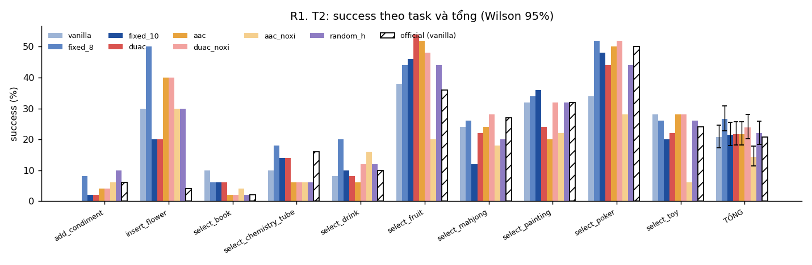

### T2.2 So sánh ghép cặp (cùng task, episode)

| so sánh | chênh lệch | CI 95% (bootstrap theo task) | chỉ adaptive thành công | chỉ fixed thành công | p McNemar | p Holm |
|---|---|---|---|---|---|---|
| duac vs vanilla | +1.1 pp | [-3.5, +5.7] | 61 | 56 | 0.712 | 1.000 |
| duac vs fixed_8 | -4.8 pp | [-9.3, -0.4] | 45 | 67 | 0.047 | 0.280 |
| duac vs fixed_10 | +0.2 pp | [-4.1, +4.6] | 51 | 50 | 1.000 | 1.000 |
| aac vs vanilla | +1.1 pp | [-3.3, +5.7] | 56 | 51 | 0.699 | 1.000 |
| aac vs fixed_8 | -4.8 pp | [-9.3, -0.2] | 50 | 72 | 0.057 | 0.284 |
| aac vs fixed_10 | +0.2 pp | [-4.1, +4.6] | 54 | 53 | 1.000 | 1.000 |
| duac_noxi vs vanilla | +3.3 pp | [-1.1, +7.6] | 63 | 48 | 0.184 | 0.918 |
| duac_noxi vs fixed_8 | -2.6 pp | [-7.2, +2.0] | 53 | 65 | 0.311 | 1.000 |
| duac_noxi vs fixed_10 | +2.4 pp | [-1.7, +6.5] | 53 | 42 | 0.305 | 1.000 |
| aac_noxi vs vanilla | -6.3 pp | [-11.1, -1.7] | 47 | 76 | 0.011 | 0.079 |
| aac_noxi vs fixed_8 | -12.2 pp | [-17.0, -7.6] | 36 | 92 | 0.000 | 0.000 |
| aac_noxi vs fixed_10 | -7.2 pp | [-11.3, -3.0] | 36 | 69 | 0.002 | 0.013 |
| random_h vs vanilla | +1.3 pp | [-3.3, +5.9] | 61 | 55 | 0.643 | 1.000 |
| random_h vs fixed_8 | -4.6 pp | [-9.3, +0.0] | 51 | 72 | 0.071 | 0.425 |
| random_h vs fixed_10 | +0.4 pp | [-4.1, +5.0] | 60 | 58 | 0.927 | 1.000 |

Kết luận so với fixed tốt nhất (fixed_8): **DUAC: NOT WORK (worse)**, **AAC: NOT WORK (worse)**, **DUAC_NOXI: INCONCLUSIVE**, **AAC_NOXI: NOT WORK (worse)**, **RANDOM_H: INCONCLUSIVE**.

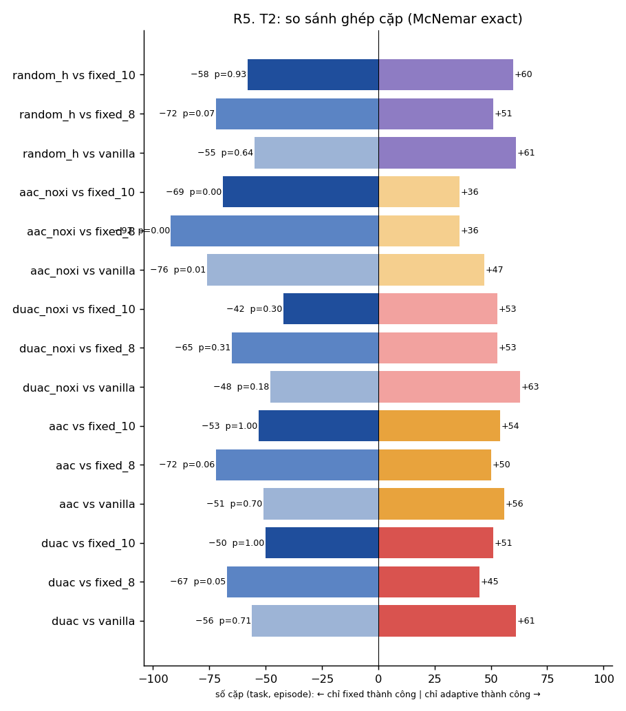 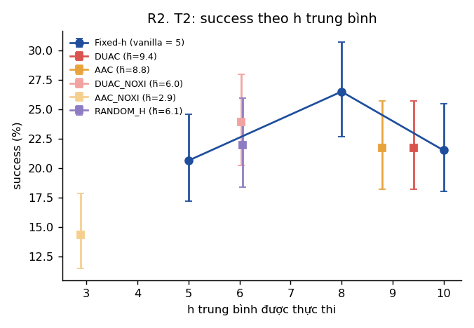

**Ablation bỏ ξ (h = h_unc) so với bản đầy đủ, và so với Random-h cùng phân phối h:**

| so sánh | chênh lệch | CI 95% | chỉ arm 1 thành công | chỉ arm 2 thành công | p McNemar | p Holm |
|---|---|---|---|---|---|---|
| duac_noxi vs duac | +2.2 pp | [-2.2, +6.5] | 57 | 47 | 0.378 | 0.755 |
| aac_noxi vs aac | -7.4 pp | [-11.7, -3.0] | 40 | 74 | 0.002 | 0.006 |
| duac_noxi vs random_h | +2.0 pp | [-2.2, +6.1] | 55 | 46 | 0.426 | 0.755 |

### T2.3 Horizon và chi phí

| arm | h̄ ± sd | decision/episode | bước tới khi thành công | gọi model (ms, đo sạch) | policy ms / action (ước tính) | thời gian/episode |
|---|---|---|---|---|---|---|
| vanilla | 5.00 ± 0.00 | 35.4 | 113 | 64.9 | 13.0 | 27 s |
| fixed_8 | 8.00 ± 0.00 | 21.8 | 111 | 71.5 | 8.9 | 23 s |
| fixed_10 | 10.00 ± 0.00 | 17.8 | 106 | 71.5 | 7.1 | 22 s |
| duac | 9.41 ± 1.45 | 19.0 | 112 | 71.5 | 7.6 | 22 s |
| aac | 8.79 ± 2.34 | 20.5 | 116 | 86.0 | 9.8 | 22 s |
| duac_noxi | 6.03 ± 3.04 | 29.6 | 112 |  |  | 25 s |
| aac_noxi | 2.88 ± 1.95 | 63.5 | 113 |  |  | 63 s |
| random_h | 6.06 ± 3.04 | 29.6 | 112 |  |  | 21 s |

`gọi model` lấy từ `check_policy.py` (một process, sau warm-up, có cả bước tính bất định). Fixed-8/10 chạy trên server DUAC nên mang chi phí của DUAC; nếu chạy bằng server vanilla thì bằng chi phí vanilla. `policy ms / action` = gọi model / h̄.

- **DUAC**: h_unc trung bình 6.40 (trung vị 8; hay gặp nhất [(9, 4241), (2, 1799), (3, 609)]), ξ trung bình 8.75, **ξ = H ở 73.5%**, ξ > h_unc ở 81.1%, h = H ở 73.5%, h_unc ≤ 2 ở 20.6%, h_unc ≥ H−1 ở 48.4%.
- **AAC**: h_unc trung bình 3.11 (trung vị 2; hay gặp nhất [(2, 6522), (3, 783), (9, 644)]), ξ trung bình 8.56, **ξ = H ở 70.8%**, ξ > h_unc ở 88.4%, h = H ở 70.8%, h_unc ≤ 2 ở 69.3%, h_unc ≥ H−1 ở 6.8%.
- **DUAC_NOXI**: h_unc trung bình 6.03 (trung vị 7; hay gặp nhất [(9, 5929), (2, 3479), (3, 1025)]), ξ trung bình 8.91, **ξ = H ở 76.7%**, ξ > h_unc ở 84.1%, h = H ở 0.0%, h_unc ≤ 2 ở 25.6%, h_unc ≥ H−1 ở 43.6%.
- **AAC_NOXI**: h_unc trung bình 2.88 (trung vị 2; hay gặp nhất [(2, 22073), (3, 2192), (9, 1686)]), ξ trung bình 8.81, **ξ = H ở 73.2%**, ξ > h_unc ở 91.2%, h = H ở 0.0%, h_unc ≤ 2 ở 75.6%, h_unc ≥ H−1 ở 5.8%.
- **RANDOM_H**: h_unc trung bình 6.47 (trung vị 8; hay gặp nhất [(9, 6737), (2, 2662), (3, 941)]), ξ trung bình 8.69, **ξ = H ở 72.5%**, ξ > h_unc ở 79.8%, h = H ở 0.0%, h_unc ≤ 2 ở 19.6%, h_unc ≥ H−1 ở 49.5%.

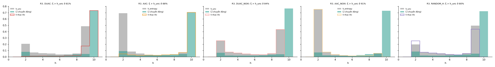 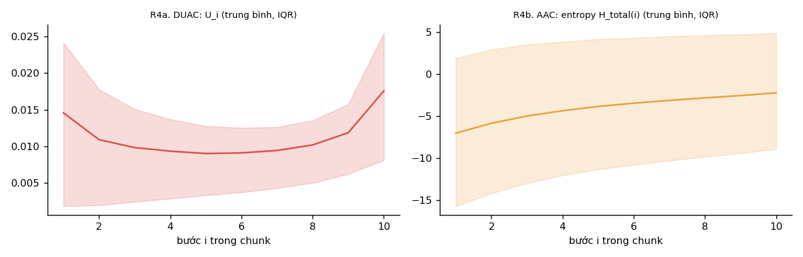

### T2.4 Tín hiệu bất định

- **DUAC**: AUROC (độ bất định trung bình của 10 decision đầu → thất bại) gộp 0.70, trung bình trong task 0.61; lag-1 autocorr h_unc 0.14; h ở chunk đổi gripper 9.62 so với 9.38.
- **AAC**: AUROC (độ bất định trung bình của 10 decision đầu → thất bại) gộp 0.83, trung bình trong task 0.78; lag-1 autocorr h_unc 0.15; h ở chunk đổi gripper 9.37 so với 8.73.
- **DUAC_NOXI**: AUROC (độ bất định trung bình của 10 decision đầu → thất bại) gộp 0.73, trung bình trong task 0.59; lag-1 autocorr h_unc 0.22; h ở chunk đổi gripper 7.71 so với 5.91.
- **AAC_NOXI**: AUROC (độ bất định trung bình của 10 decision đầu → thất bại) gộp 0.58, trung bình trong task 0.41; lag-1 autocorr h_unc 0.21; h ở chunk đổi gripper 6.31 so với 2.79.
- **RANDOM_H**: AUROC (độ bất định trung bình của 10 decision đầu → thất bại) gộp 0.73, trung bình trong task 0.63; lag-1 autocorr h_unc 0.19; h ở chunk đổi gripper 7.93 so với 5.89.

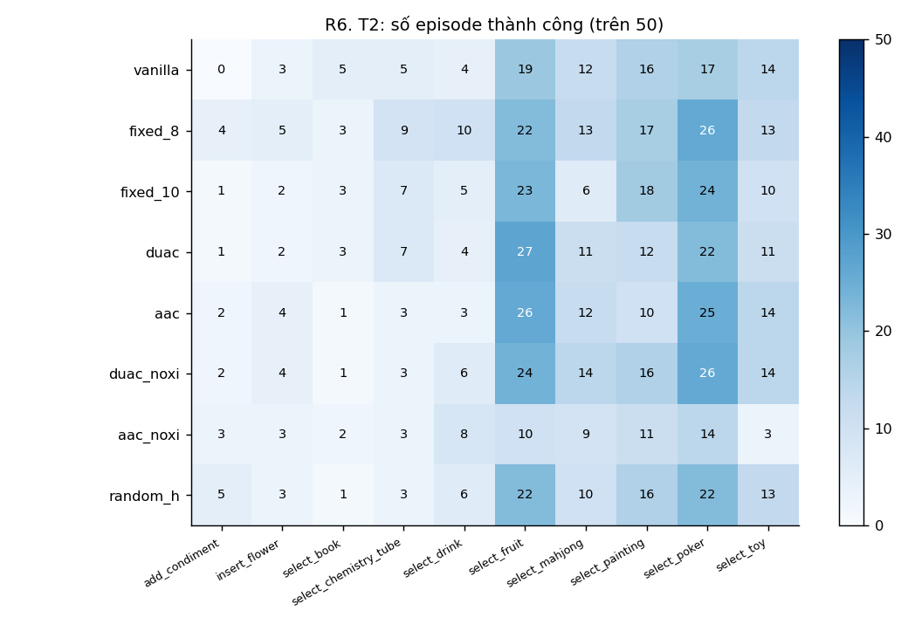 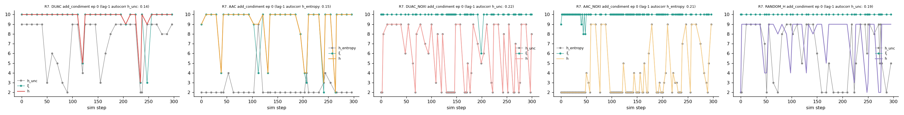 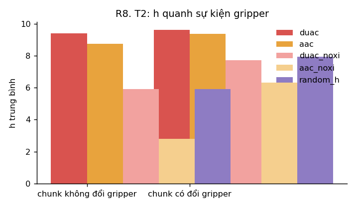

## T3 — `track_3_common_sense`

500 episode ghép cặp/arm (add_condiment 50, insert_flower 50, select_book 50, select_chemistry_tube 50, select_drink 50, select_fruit 50, select_nth_largest_poker 50, select_painting 50, select_toy 50, select_unique_type_mahjong 50). Episode lỗi mô phỏng (tính là thất bại): vanilla 13, fixed_8 5, fixed_10 9, duac 8, aac 8, duac_noxi 13, aac_noxi 7, random_h 6.

### T3.1 Success

| task | official (vanilla) | vanilla | fixed_8 | fixed_10 | duac | aac | duac_noxi | aac_noxi | random_h |
|---|---|---|---|---|---|---|---|---|---|
| add_condiment | 0.2 | 4/50 | 5/50 | 6/50 | 8/50 | 6/50 | **9**/50 | 2/50 | 3/50 |
| insert_flower | 0.1 | 5/50 | **9**/50 | 5/50 | 2/50 | 5/50 | 7/50 | 6/50 | 5/50 |
| select_book | 0.383 | 13/50 | **24**/50 | 17/50 | 13/50 | 18/50 | 12/50 | 12/50 | 23/50 |
| select_chemistry_tube | 0.32 | 16/50 | **29**/50 | 27/50 | 26/50 | 27/50 | 21/50 | 11/50 | 22/50 |
| select_drink | 0.1 | 6/50 | 7/50 | 5/50 | 4/50 | 5/50 | 8/50 | 3/50 | **11**/50 |
| select_fruit | 0.2 | 9/50 | 15/50 | 16/50 | 16/50 | 17/50 | **18**/50 | 7/50 | 8/50 |
| select_nth_largest_poker | 0.2 | **9**/50 | 6/50 | 3/50 | 7/50 | 6/50 | 8/50 | 2/50 | 7/50 |
| select_painting | 0.24 | 11/50 | 11/50 | 11/50 | 6/50 | 10/50 | 9/50 | **12**/50 | 9/50 |
| select_toy | 0.06 | 0/50 | 5/50 | **8**/50 | 6/50 | **8**/50 | 4/50 | 0/50 | 3/50 |
| select_unique_type_mahjong | 0.0 | 1/50 | **5**/50 | 4/50 | 4/50 | 2/50 | 4/50 | 2/50 | 4/50 |
| **Tổng** | 18.0% | **14.8%** [12–18] | **23.2%** [20–27] | **20.4%** [17–24] | **18.4%** [15–22] | **20.8%** [17–25] | **20.0%** [17–24] | **11.4%** [9–14] | **19.0%** [16–23] |
| progress score | | 0.320 | 0.388 | 0.362 | 0.350 | 0.368 | 0.363 | 0.283 | 0.366 |

Fixed tốt nhất: **fixed_8**. Chọn fixed tốt nhất riêng từng task (sau khi biết kết quả, cận trên mọi lựa chọn cố định): 24.8%.

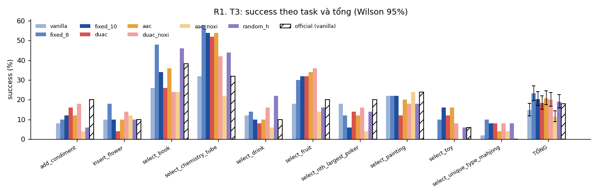

### T3.2 So sánh ghép cặp (cùng task, episode)

| so sánh | chênh lệch | CI 95% (bootstrap theo task) | chỉ adaptive thành công | chỉ fixed thành công | p McNemar | p Holm |
|---|---|---|---|---|---|---|
| duac vs vanilla | +3.6 pp | [-0.4, +7.6] | 65 | 47 | 0.108 | 0.431 |
| duac vs fixed_8 | -4.8 pp | [-9.2, -0.4] | 57 | 81 | 0.050 | 0.249 |
| duac vs fixed_10 | -2.0 pp | [-6.2, +2.2] | 53 | 63 | 0.403 | 1.000 |
| aac vs vanilla | +6.0 pp | [+2.0, +10.0] | 69 | 39 | 0.005 | 0.030 |
| aac vs fixed_8 | -2.4 pp | [-7.0, +2.2] | 63 | 75 | 0.349 | 1.000 |
| aac vs fixed_10 | +0.4 pp | [-3.8, +4.8] | 64 | 62 | 0.929 | 1.000 |
| duac_noxi vs vanilla | +5.2 pp | [+1.0, +9.4] | 70 | 44 | 0.019 | 0.132 |
| duac_noxi vs fixed_8 | -3.2 pp | [-7.6, +1.4] | 60 | 76 | 0.198 | 0.595 |
| duac_noxi vs fixed_10 | -0.4 pp | [-4.8, +3.8] | 64 | 66 | 0.930 | 1.000 |
| aac_noxi vs vanilla | -3.4 pp | [-6.8, +0.0] | 33 | 50 | 0.078 | 0.357 |
| aac_noxi vs fixed_8 | -11.8 pp | [-15.8, -7.8] | 29 | 88 | 0.000 | 0.000 |
| aac_noxi vs fixed_10 | -9.0 pp | [-13.2, -4.8] | 42 | 87 | 0.000 | 0.001 |
| random_h vs vanilla | +4.2 pp | [+0.0, +8.2] | 67 | 46 | 0.059 | 0.357 |
| random_h vs fixed_8 | -4.2 pp | [-8.4, +0.2] | 50 | 71 | 0.069 | 0.357 |
| random_h vs fixed_10 | -1.4 pp | [-5.8, +3.0] | 59 | 66 | 0.592 | 1.000 |

Kết luận so với fixed tốt nhất (fixed_8): **DUAC: NOT WORK (worse)**, **AAC: INCONCLUSIVE**, **DUAC_NOXI: INCONCLUSIVE**, **AAC_NOXI: NOT WORK (worse)**, **RANDOM_H: INCONCLUSIVE**.

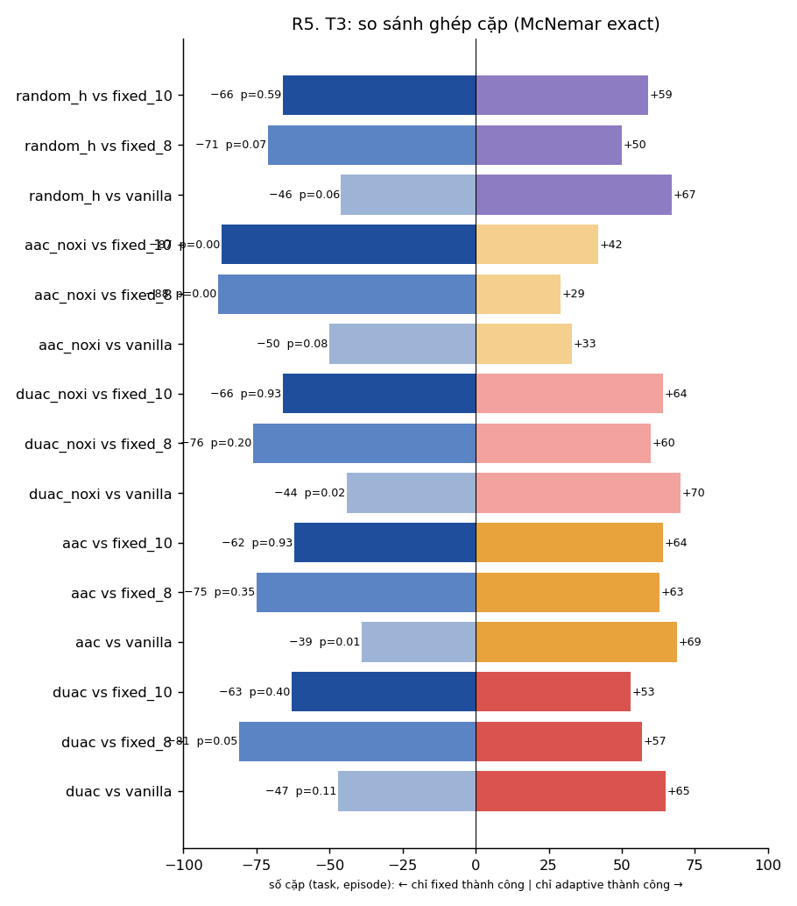 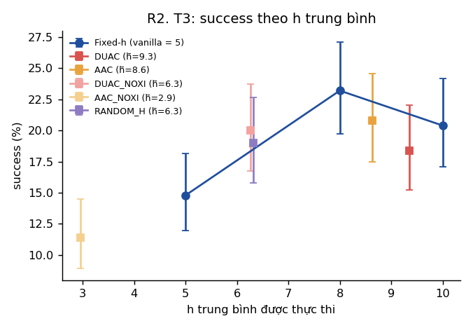

**Ablation bỏ ξ (h = h_unc) so với bản đầy đủ, và so với Random-h cùng phân phối h:**

| so sánh | chênh lệch | CI 95% | chỉ arm 1 thành công | chỉ arm 2 thành công | p McNemar | p Holm |
|---|---|---|---|---|---|---|
| duac_noxi vs duac | +1.6 pp | [-3.0, +6.0] | 72 | 64 | 0.549 | 1.000 |
| aac_noxi vs aac | -9.4 pp | [-13.2, -5.6] | 28 | 75 | 0.000 | 0.000 |
| duac_noxi vs random_h | +1.0 pp | [-3.6, +5.6] | 70 | 65 | 0.731 | 1.000 |

### T3.3 Horizon và chi phí

| arm | h̄ ± sd | decision/episode | bước tới khi thành công | gọi model (ms, đo sạch) | policy ms / action (ước tính) | thời gian/episode |
|---|---|---|---|---|---|---|
| vanilla | 5.00 ± 0.00 | 35.4 | 105 | 64.9 | 13.0 | 27 s |
| fixed_8 | 8.00 ± 0.00 | 21.6 | 110 | 71.5 | 8.9 | 17 s |
| fixed_10 | 10.00 ± 0.00 | 17.4 | 113 | 71.5 | 7.1 | 16 s |
| duac | 9.35 ± 1.46 | 18.9 | 113 | 71.5 | 7.6 | 16 s |
| aac | 8.63 ± 2.48 | 20.4 | 114 | 86.0 | 10.0 | 17 s |
| duac_noxi | 6.26 ± 3.01 | 28.3 | 121 |  |  | 28 s |
| aac_noxi | 2.95 ± 2.04 | 62.3 | 116 |  |  | 50 s |
| random_h | 6.31 ± 2.99 | 28.0 | 106 |  |  | 22 s |

`gọi model` lấy từ `check_policy.py` (một process, sau warm-up, có cả bước tính bất định). Fixed-8/10 chạy trên server DUAC nên mang chi phí của DUAC; nếu chạy bằng server vanilla thì bằng chi phí vanilla. `policy ms / action` = gọi model / h̄.

- **DUAC**: h_unc trung bình 6.54 (trung vị 9; hay gặp nhất [(9, 4844), (2, 1826), (3, 617)]), ξ trung bình 8.44, **ξ = H ở 68.9%**, ξ > h_unc ở 77.3%, h = H ở 68.9%, h_unc ≤ 2 ở 19.3%, h_unc ≥ H−1 ở 51.2%.
- **AAC**: h_unc trung bình 3.36 (trung vị 2; hay gặp nhất [(2, 6800), (9, 1018), (3, 765)]), ξ trung bình 8.31, **ξ = H ở 67.0%**, ξ > h_unc ở 85.3%, h = H ở 67.0%, h_unc ≤ 2 ở 66.6%, h_unc ≥ H−1 ở 10.0%.
- **DUAC_NOXI**: h_unc trung bình 6.26 (trung vị 8; hay gặp nhất [(9, 6689), (2, 3298), (3, 961)]), ξ trung bình 8.65, **ξ = H ở 72.1%**, ξ > h_unc ở 80.9%, h = H ở 0.0%, h_unc ≤ 2 ở 23.3%, h_unc ≥ H−1 ở 47.3%.
- **AAC_NOXI**: h_unc trung bình 2.95 (trung vị 2; hay gặp nhất [(2, 23304), (3, 2206), (9, 2074)]), ξ trung bình 8.66, **ξ = H ở 70.7%**, ξ > h_unc ở 89.1%, h = H ở 0.0%, h_unc ≤ 2 ở 74.8%, h_unc ≥ H−1 ở 6.7%.
- **RANDOM_H**: h_unc trung bình 6.62 (trung vị 9; hay gặp nhất [(9, 7387), (2, 2580), (3, 932)]), ξ trung bình 8.38, **ξ = H ở 68.1%**, ξ > h_unc ở 76.1%, h = H ở 0.0%, h_unc ≤ 2 ở 18.4%, h_unc ≥ H−1 ở 52.8%.

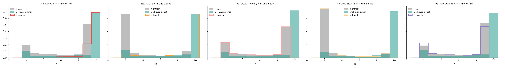 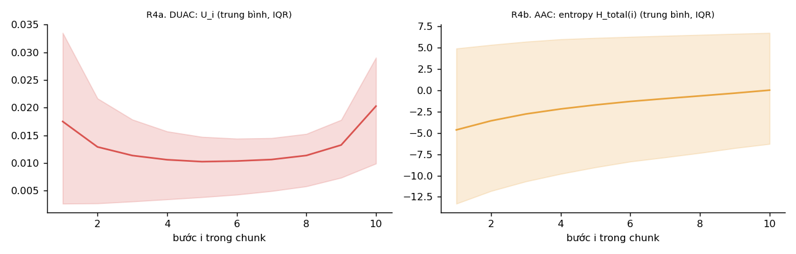

### T3.4 Tín hiệu bất định

- **DUAC**: AUROC (độ bất định trung bình của 10 decision đầu → thất bại) gộp 0.68, trung bình trong task 0.69; lag-1 autocorr h_unc 0.13; h ở chunk đổi gripper 9.48 so với 9.33.
- **AAC**: AUROC (độ bất định trung bình của 10 decision đầu → thất bại) gộp 0.72, trung bình trong task 0.76; lag-1 autocorr h_unc 0.13; h ở chunk đổi gripper 9.21 so với 8.57.
- **DUAC_NOXI**: AUROC (độ bất định trung bình của 10 decision đầu → thất bại) gộp 0.61, trung bình trong task 0.62; lag-1 autocorr h_unc 0.19; h ở chunk đổi gripper 7.83 so với 6.14.
- **AAC_NOXI**: AUROC (độ bất định trung bình của 10 decision đầu → thất bại) gộp 0.60, trung bình trong task 0.64; lag-1 autocorr h_unc 0.19; h ở chunk đổi gripper 6.28 so với 2.87.
- **RANDOM_H**: AUROC (độ bất định trung bình của 10 decision đầu → thất bại) gộp 0.66, trung bình trong task 0.75; lag-1 autocorr h_unc 0.15; h ở chunk đổi gripper 8.04 so với 6.16.

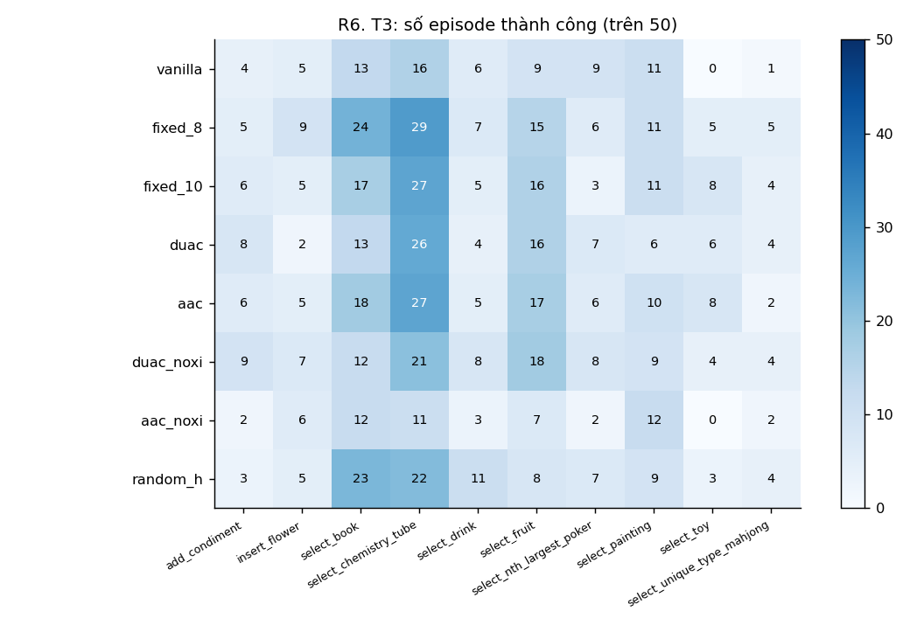 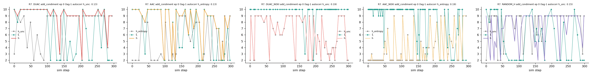 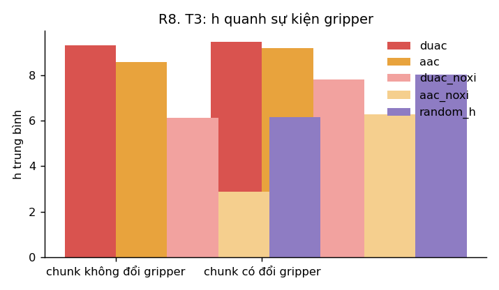

## T4 — `track_4_semantic_instruction`

500 episode ghép cặp/arm (add_condiment 50, insert_flower 50, select_book 50, select_chemistry_tube 50, select_drink 50, select_fruit 50, select_mahjong 50, select_painting 50, select_poker 50, select_toy 50). Episode lỗi mô phỏng (tính là thất bại): vanilla 10, fixed_8 12, fixed_10 10, duac 7, aac 5, duac_noxi 12, aac_noxi 6, random_h 10.

### T4.1 Success

| task | official (vanilla) | vanilla | fixed_8 | fixed_10 | duac | aac | duac_noxi | aac_noxi | random_h |
|---|---|---|---|---|---|---|---|---|---|
| add_condiment | 0.02 | **8**/50 | 5/50 | 5/50 | 6/50 | 5/50 | 5/50 | 5/50 | 4/50 |
| insert_flower | 0.1 | 1/50 | 4/50 | 1/50 | 4/50 | **5**/50 | 3/50 | 4/50 | 2/50 |
| select_book | 0.333 | 18/50 | 19/50 | 14/50 | 12/50 | **23**/50 | 15/50 | 16/50 | 21/50 |
| select_chemistry_tube | 0.245 | 13/50 | 9/50 | **18**/50 | 10/50 | 13/50 | 11/50 | 9/50 | 14/50 |
| select_drink | 0.3 | 10/50 | **15**/50 | 9/50 | 10/50 | 7/50 | 4/50 | 7/50 | 8/50 |
| select_fruit | 0.14 | 8/50 | 9/50 | 14/50 | 14/50 | 8/50 | 9/50 | 5/50 | **15**/50 |
| select_mahjong | 0.205 | 6/50 | 7/50 | 7/50 | 8/50 | 5/50 | 5/50 | **10**/50 | 9/50 |
| select_painting | 0.12 | 3/50 | 4/50 | 5/50 | 5/50 | **8**/50 | 7/50 | **8**/50 | 5/50 |
| select_poker | 0.04 | 4/50 | 3/50 | 7/50 | 4/50 | 5/50 | **11**/50 | 3/50 | 6/50 |
| select_toy | 0.074 | 2/50 | 4/50 | **7**/50 | 5/50 | 4/50 | 1/50 | 0/50 | 5/50 |
| **Tổng** | 15.8% | **14.6%** [12–18] | **15.8%** [13–19] | **17.4%** [14–21] | **15.6%** [13–19] | **16.6%** [14–20] | **14.2%** [11–18] | **13.4%** [11–17] | **17.8%** [15–21] |
| progress score | | 0.313 | 0.344 | 0.351 | 0.350 | 0.358 | 0.339 | 0.313 | 0.356 |

Fixed tốt nhất: **fixed_10**. Chọn fixed tốt nhất riêng từng task (sau khi biết kết quả, cận trên mọi lựa chọn cố định): 20.8%.

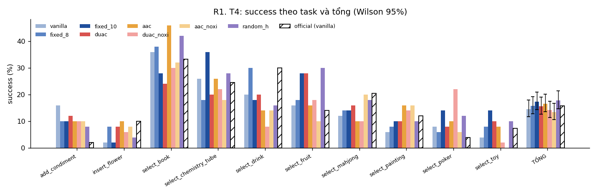

### T4.2 So sánh ghép cặp (cùng task, episode)

| so sánh | chênh lệch | CI 95% (bootstrap theo task) | chỉ adaptive thành công | chỉ fixed thành công | p McNemar | p Holm |
|---|---|---|---|---|---|---|
| duac vs vanilla | +1.0 pp | [-3.4, +5.2] | 63 | 58 | 0.716 | 1.000 |
| duac vs fixed_8 | -0.2 pp | [-4.6, +4.0] | 63 | 64 | 1.000 | 1.000 |
| duac vs fixed_10 | -1.8 pp | [-6.0, +2.6] | 57 | 66 | 0.471 | 1.000 |
| aac vs vanilla | +2.0 pp | [-2.2, +6.0] | 63 | 53 | 0.403 | 1.000 |
| aac vs fixed_8 | +0.8 pp | [-3.2, +4.8] | 57 | 53 | 0.775 | 1.000 |
| aac vs fixed_10 | -0.8 pp | [-5.0, +3.6] | 60 | 64 | 0.788 | 1.000 |
| duac_noxi vs vanilla | -0.4 pp | [-4.6, +3.8] | 58 | 60 | 0.927 | 1.000 |
| duac_noxi vs fixed_8 | -1.6 pp | [-5.6, +2.4] | 51 | 59 | 0.505 | 1.000 |
| duac_noxi vs fixed_10 | -3.2 pp | [-7.4, +1.0] | 53 | 69 | 0.174 | 1.000 |
| aac_noxi vs vanilla | -1.2 pp | [-5.4, +2.8] | 51 | 57 | 0.631 | 1.000 |
| aac_noxi vs fixed_8 | -2.4 pp | [-6.4, +1.6] | 43 | 55 | 0.266 | 1.000 |
| aac_noxi vs fixed_10 | -4.0 pp | [-8.2, +0.2] | 52 | 72 | 0.088 | 0.788 |
| random_h vs vanilla | +3.2 pp | [-0.8, +7.4] | 62 | 46 | 0.149 | 1.000 |
| random_h vs fixed_8 | +2.0 pp | [-2.2, +6.2] | 68 | 58 | 0.423 | 1.000 |
| random_h vs fixed_10 | +0.4 pp | [-3.8, +4.8] | 65 | 63 | 0.930 | 1.000 |

Kết luận so với fixed tốt nhất (fixed_10): **DUAC: INCONCLUSIVE**, **AAC: INCONCLUSIVE**, **DUAC_NOXI: INCONCLUSIVE**, **AAC_NOXI: INCONCLUSIVE**, **RANDOM_H: INCONCLUSIVE**.

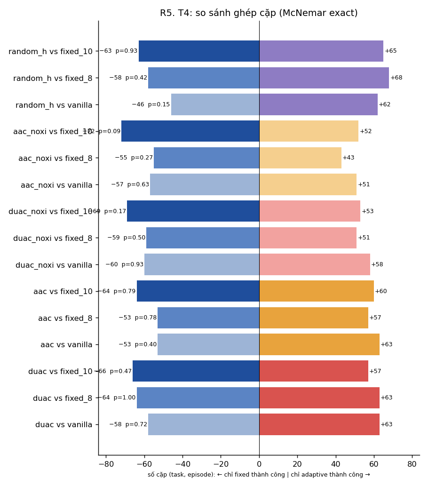 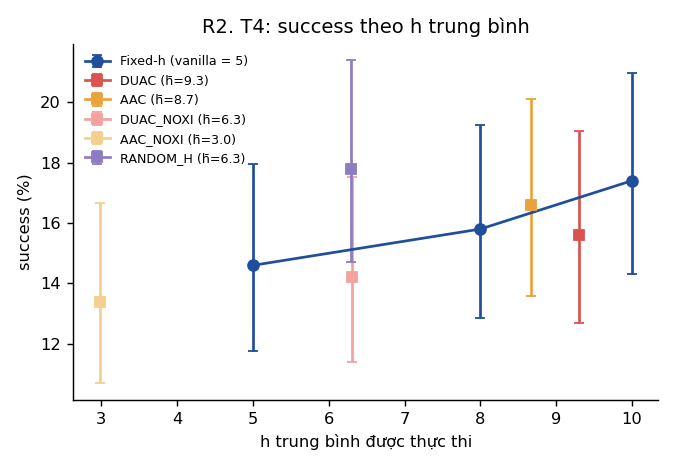

**Ablation bỏ ξ (h = h_unc) so với bản đầy đủ, và so với Random-h cùng phân phối h:**

| so sánh | chênh lệch | CI 95% | chỉ arm 1 thành công | chỉ arm 2 thành công | p McNemar | p Holm |
|---|---|---|---|---|---|---|
| duac_noxi vs duac | -1.4 pp | [-5.8, +2.8] | 56 | 63 | 0.582 | 0.582 |
| aac_noxi vs aac | -3.2 pp | [-7.4, +1.0] | 50 | 66 | 0.163 | 0.327 |
| duac_noxi vs random_h | -3.6 pp | [-7.6, +0.4] | 47 | 65 | 0.108 | 0.323 |

### T4.3 Horizon và chi phí

| arm | h̄ ± sd | decision/episode | bước tới khi thành công | gọi model (ms, đo sạch) | policy ms / action (ước tính) | thời gian/episode |
|---|---|---|---|---|---|---|
| vanilla | 5.00 ± 0.00 | 35.3 | 113 | 64.9 | 13.0 | 29 s |
| fixed_8 | 8.00 ± 0.00 | 21.9 | 109 | 71.5 | 8.9 | 19 s |
| fixed_10 | 10.00 ± 0.00 | 17.5 | 114 | 71.5 | 7.1 | 17 s |
| duac | 9.31 ± 1.54 | 19.4 | 117 | 71.5 | 7.7 | 18 s |
| aac | 8.67 ± 2.46 | 20.8 | 114 | 86.0 | 9.9 | 21 s |
| duac_noxi | 6.30 ± 3.01 | 28.8 | 116 |  |  | 27 s |
| aac_noxi | 2.98 ± 2.09 | 60.6 | 115 |  |  | 37 s |
| random_h | 6.29 ± 3.01 | 28.3 | 112 |  |  | 22 s |

`gọi model` lấy từ `check_policy.py` (một process, sau warm-up, có cả bước tính bất định). Fixed-8/10 chạy trên server DUAC nên mang chi phí của DUAC; nếu chạy bằng server vanilla thì bằng chi phí vanilla. `policy ms / action` = gọi model / h̄.

- **DUAC**: h_unc trung bình 6.54 (trung vị 9; hay gặp nhất [(9, 4980), (2, 1834), (3, 686)]), ξ trung bình 8.41, **ξ = H ở 69.3%**, ξ > h_unc ở 77.8%, h = H ở 69.3%, h_unc ≤ 2 ở 18.9%, h_unc ≥ H−1 ở 51.3%.
- **AAC**: h_unc trung bình 3.29 (trung vị 2; hay gặp nhất [(2, 7064), (9, 968), (3, 752)]), ξ trung bình 8.37, **ξ = H ở 69.1%**, ξ > h_unc ở 85.8%, h = H ở 69.1%, h_unc ≤ 2 ở 67.8%, h_unc ≥ H−1 ở 9.3%.
- **DUAC_NOXI**: h_unc trung bình 6.30 (trung vị 8; hay gặp nhất [(9, 6977), (2, 3273), (3, 1028)]), ξ trung bình 8.52, **ξ = H ở 71.0%**, ξ > h_unc ở 80.1%, h = H ở 0.0%, h_unc ≤ 2 ở 22.7%, h_unc ≥ H−1 ở 48.4%.
- **AAC_NOXI**: h_unc trung bình 2.98 (trung vị 2; hay gặp nhất [(2, 22702), (9, 2143), (3, 1966)]), ξ trung bình 8.69, **ξ = H ở 72.2%**, ξ > h_unc ở 89.6%, h = H ở 0.0%, h_unc ≤ 2 ở 74.9%, h_unc ≥ H−1 ở 7.1%.
- **RANDOM_H**: h_unc trung bình 6.61 (trung vị 9; hay gặp nhất [(9, 7474), (2, 2747), (3, 892)]), ξ trung bình 8.46, **ξ = H ở 70.2%**, ξ > h_unc ở 78.0%, h = H ở 0.0%, h_unc ≤ 2 ở 19.4%, h_unc ≥ H−1 ở 52.9%.

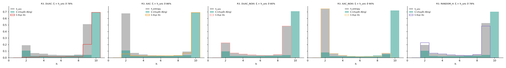 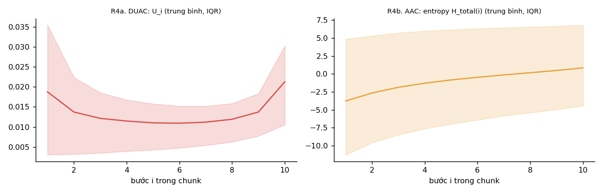

### T4.4 Tín hiệu bất định

- **DUAC**: AUROC (độ bất định trung bình của 10 decision đầu → thất bại) gộp 0.69, trung bình trong task 0.73; lag-1 autocorr h_unc 0.1; h ở chunk đổi gripper 9.54 so với 9.28.
- **AAC**: AUROC (độ bất định trung bình của 10 decision đầu → thất bại) gộp 0.71, trung bình trong task 0.79; lag-1 autocorr h_unc 0.14; h ở chunk đổi gripper 9.31 so với 8.59.
- **DUAC_NOXI**: AUROC (độ bất định trung bình của 10 decision đầu → thất bại) gộp 0.63, trung bình trong task 0.69; lag-1 autocorr h_unc 0.18; h ở chunk đổi gripper 7.64 so với 6.19.
- **AAC_NOXI**: AUROC (độ bất định trung bình của 10 decision đầu → thất bại) gộp 0.49, trung bình trong task 0.51; lag-1 autocorr h_unc 0.19; h ở chunk đổi gripper 6.16 so với 2.89.
- **RANDOM_H**: AUROC (độ bất định trung bình của 10 decision đầu → thất bại) gộp 0.67, trung bình trong task 0.73; lag-1 autocorr h_unc 0.15; h ở chunk đổi gripper 7.84 so với 6.16.

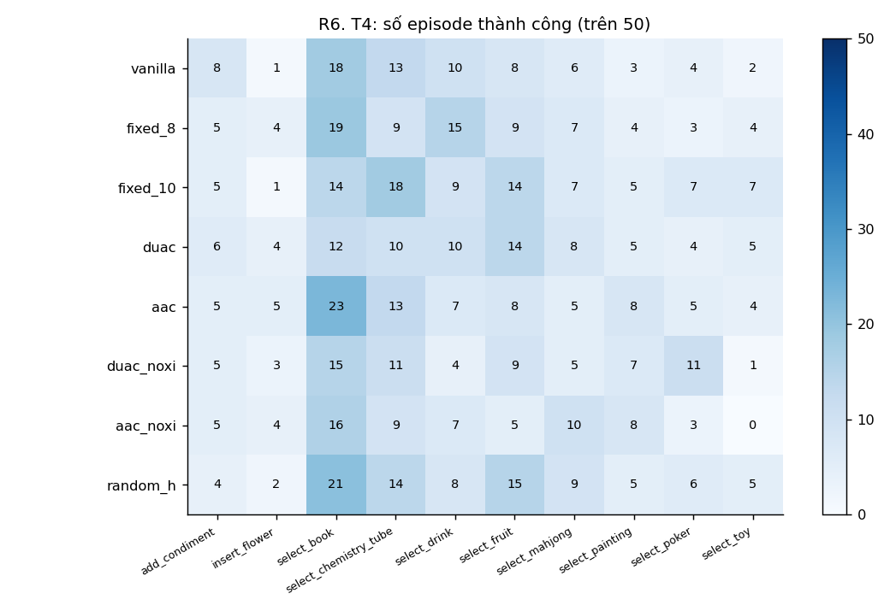 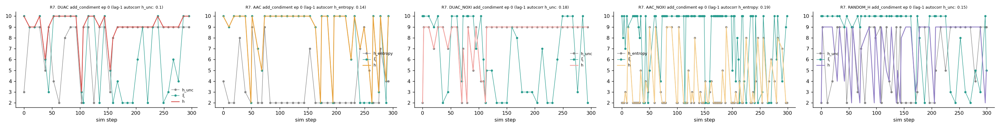 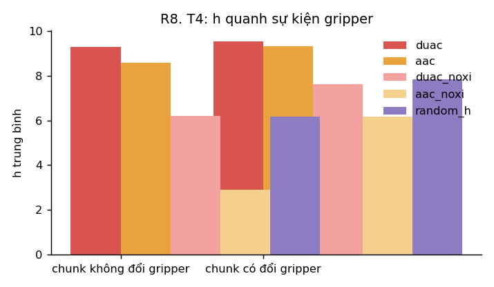

## T6 — `track_6_unseen_texture`

500 episode ghép cặp/arm (add_condiment 50, insert_flower 50, select_book 50, select_chemistry_tube 50, select_drink 50, select_fruit 50, select_mahjong 50, select_painting 50, select_poker 50, select_toy 50). Episode lỗi mô phỏng (tính là thất bại): vanilla 9, fixed_8 6, fixed_10 9, duac 7, aac 8, duac_noxi 8, aac_noxi 8, random_h 12.

### T6.1 Success

| task | official (vanilla) | vanilla | fixed_8 | fixed_10 | duac | aac | duac_noxi | aac_noxi | random_h |
|---|---|---|---|---|---|---|---|---|---|
| add_condiment | 0.48 | 15/50 | 24/50 | 19/50 | **28**/50 | 18/50 | 17/50 | 11/50 | 19/50 |
| insert_flower | 0.1 | 1/50 | 3/50 | 3/50 | 5/50 | 5/50 | **7**/50 | 0/50 | 0/50 |
| select_book | 0.383 | 21/50 | 22/50 | 22/50 | **26**/50 | 21/50 | 19/50 | 15/50 | 25/50 |
| select_chemistry_tube | 0.354 | 20/50 | 16/50 | 11/50 | 11/50 | **21**/50 | 13/50 | 5/50 | 12/50 |
| select_drink | 0.18 | 7/50 | 9/50 | 8/50 | 11/50 | 11/50 | 10/50 | 9/50 | **12**/50 |
| select_fruit | 0.2 | 10/50 | **14**/50 | **14**/50 | 10/50 | 10/50 | 11/50 | 6/50 | 13/50 |
| select_mahjong | 0.217 | 7/50 | 6/50 | 13/50 | 9/50 | **14**/50 | 11/50 | 11/50 | 7/50 |
| select_painting | 0.3 | 8/50 | 13/50 | 15/50 | **17**/50 | 11/50 | 11/50 | 13/50 | 13/50 |
| select_poker | 0.32 | 11/50 | 16/50 | 18/50 | 14/50 | 14/50 | **21**/50 | 11/50 | 13/50 |
| select_toy | 0.08 | 6/50 | 8/50 | **15**/50 | 6/50 | 4/50 | 7/50 | 5/50 | 7/50 |
| **Tổng** | 26.1% | **21.2%** [18–25] | **26.2%** [23–30] | **27.6%** [24–32] | **27.4%** [24–31] | **25.8%** [22–30] | **25.4%** [22–29] | **17.2%** [14–21] | **24.2%** [21–28] |
| progress score | | 0.377 | 0.423 | 0.441 | 0.457 | 0.431 | 0.451 | 0.365 | 0.421 |

Fixed tốt nhất: **fixed_10**. Chọn fixed tốt nhất riêng từng task (sau khi biết kết quả, cận trên mọi lựa chọn cố định): 30.6%.

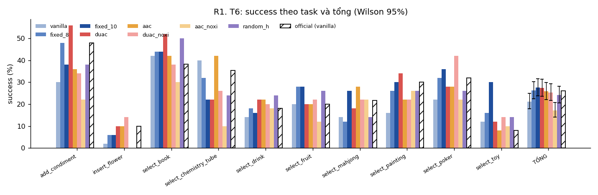

### T6.2 So sánh ghép cặp (cùng task, episode)

| so sánh | chênh lệch | CI 95% (bootstrap theo task) | chỉ adaptive thành công | chỉ fixed thành công | p McNemar | p Holm |
|---|---|---|---|---|---|---|
| duac vs vanilla | +6.2 pp | [+1.4, +11.0] | 94 | 63 | 0.016 | 0.098 |
| duac vs fixed_8 | +1.2 pp | [-3.6, +5.8] | 77 | 71 | 0.681 | 1.000 |
| duac vs fixed_10 | -0.2 pp | [-5.4, +5.0] | 86 | 87 | 1.000 | 1.000 |
| aac vs vanilla | +4.6 pp | [+0.0, +9.4] | 87 | 64 | 0.073 | 0.365 |
| aac vs fixed_8 | -0.4 pp | [-5.0, +4.2] | 72 | 74 | 0.934 | 1.000 |
| aac vs fixed_10 | -1.8 pp | [-6.8, +3.2] | 76 | 85 | 0.529 | 1.000 |
| duac_noxi vs vanilla | +4.2 pp | [-0.6, +9.0] | 86 | 65 | 0.103 | 0.649 |
| duac_noxi vs fixed_8 | -0.8 pp | [-5.6, +4.2] | 76 | 80 | 0.810 | 1.000 |
| duac_noxi vs fixed_10 | -2.2 pp | [-7.4, +2.6] | 78 | 89 | 0.439 | 1.000 |
| aac_noxi vs vanilla | -4.0 pp | [-8.2, +0.2] | 54 | 74 | 0.093 | 0.649 |
| aac_noxi vs fixed_8 | -9.0 pp | [-13.4, -4.6] | 48 | 93 | 0.000 | 0.002 |
| aac_noxi vs fixed_10 | -10.4 pp | [-15.0, -5.8] | 48 | 100 | 0.000 | 0.000 |
| random_h vs vanilla | +3.0 pp | [-1.4, +7.2] | 74 | 59 | 0.225 | 0.993 |
| random_h vs fixed_8 | -2.0 pp | [-6.6, +2.8] | 68 | 78 | 0.456 | 1.000 |
| random_h vs fixed_10 | -3.4 pp | [-8.2, +1.6] | 69 | 86 | 0.199 | 0.993 |

Kết luận so với fixed tốt nhất (fixed_10): **DUAC: INCONCLUSIVE**, **AAC: INCONCLUSIVE**, **DUAC_NOXI: INCONCLUSIVE**, **AAC_NOXI: NOT WORK (worse)**, **RANDOM_H: INCONCLUSIVE**.

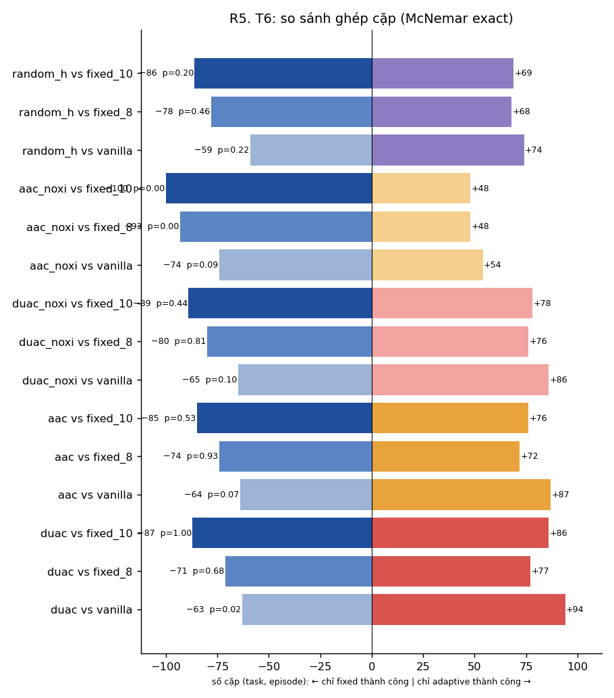 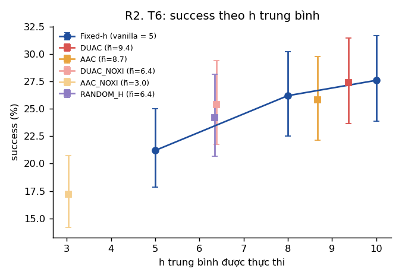

**Ablation bỏ ξ (h = h_unc) so với bản đầy đủ, và so với Random-h cùng phân phối h:**

| so sánh | chênh lệch | CI 95% | chỉ arm 1 thành công | chỉ arm 2 thành công | p McNemar | p Holm |
|---|---|---|---|---|---|---|
| duac_noxi vs duac | -2.0 pp | [-7.0, +3.0] | 77 | 87 | 0.482 | 0.965 |
| aac_noxi vs aac | -8.6 pp | [-13.4, -4.0] | 54 | 97 | 0.001 | 0.002 |
| duac_noxi vs random_h | +1.2 pp | [-3.6, +6.2] | 82 | 76 | 0.691 | 0.965 |

### T6.3 Horizon và chi phí

| arm | h̄ ± sd | decision/episode | bước tới khi thành công | gọi model (ms, đo sạch) | policy ms / action (ước tính) | thời gian/episode |
|---|---|---|---|---|---|---|
| vanilla | 5.00 ± 0.00 | 34.2 | 111 | 64.9 | 13.0 | 26 s |
| fixed_8 | 8.00 ± 0.00 | 21.1 | 112 | 71.5 | 8.9 | 20 s |
| fixed_10 | 10.00 ± 0.00 | 16.9 | 113 | 71.5 | 7.1 | 19 s |
| duac | 9.37 ± 1.44 | 18.1 | 113 | 71.5 | 7.6 | 19 s |
| aac | 8.68 ± 2.42 | 19.6 | 106 | 86.0 | 9.9 | 19 s |
| duac_noxi | 6.39 ± 2.95 | 26.9 | 110 |  |  | 23 s |
| aac_noxi | 3.03 ± 2.09 | 59.2 | 116 |  |  | 39 s |
| random_h | 6.35 ± 2.95 | 26.8 | 108 |  |  | 21 s |

`gọi model` lấy từ `check_policy.py` (một process, sau warm-up, có cả bước tính bất định). Fixed-8/10 chạy trên server DUAC nên mang chi phí của DUAC; nếu chạy bằng server vanilla thì bằng chi phí vanilla. `policy ms / action` = gọi model / h̄.

- **DUAC**: h_unc trung bình 6.65 (trung vị 9; hay gặp nhất [(9, 4756), (2, 1631), (3, 550)]), ξ trung bình 8.55, **ξ = H ở 69.7%**, ξ > h_unc ở 77.2%, h = H ở 69.7%, h_unc ≤ 2 ở 18.0%, h_unc ≥ H−1 ở 52.5%.
- **AAC**: h_unc trung bình 3.31 (trung vị 2; hay gặp nhất [(2, 6488), (9, 873), (3, 777)]), ξ trung bình 8.38, **ξ = H ở 67.4%**, ξ > h_unc ở 85.9%, h = H ở 67.4%, h_unc ≤ 2 ở 66.3%, h_unc ≥ H−1 ở 8.9%.
- **DUAC_NOXI**: h_unc trung bình 6.39 (trung vị 8; hay gặp nhất [(9, 6516), (2, 2774), (3, 967)]), ξ trung bình 8.62, **ξ = H ở 71.3%**, ξ > h_unc ở 79.3%, h = H ở 0.0%, h_unc ≤ 2 ở 20.6%, h_unc ≥ H−1 ở 48.4%.
- **AAC_NOXI**: h_unc trung bình 3.03 (trung vị 2; hay gặp nhất [(2, 21486), (3, 2111), (9, 2086)]), ξ trung bình 8.59, **ξ = H ở 67.9%**, ξ > h_unc ở 89.1%, h = H ở 0.0%, h_unc ≤ 2 ở 72.6%, h_unc ≥ H−1 ở 7.1%.
- **RANDOM_H**: h_unc trung bình 6.65 (trung vị 9; hay gặp nhất [(9, 6960), (2, 2324), (3, 841)]), ξ trung bình 8.53, **ξ = H ở 70.0%**, ξ > h_unc ở 77.3%, h = H ở 0.0%, h_unc ≤ 2 ở 17.3%, h_unc ≥ H−1 ở 51.9%.

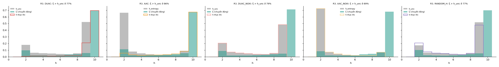 

### T6.4 Tín hiệu bất định

- **DUAC**: AUROC (độ bất định trung bình của 10 decision đầu → thất bại) gộp 0.70, trung bình trong task 0.75; lag-1 autocorr h_unc 0.11; h ở chunk đổi gripper 9.65 so với 9.33.
- **AAC**: AUROC (độ bất định trung bình của 10 decision đầu → thất bại) gộp 0.75, trung bình trong task 0.84; lag-1 autocorr h_unc 0.15; h ở chunk đổi gripper 9.39 so với 8.59.
- **DUAC_NOXI**: AUROC (độ bất định trung bình của 10 decision đầu → thất bại) gộp 0.64, trung bình trong task 0.67; lag-1 autocorr h_unc 0.18; h ở chunk đổi gripper 7.83 so với 6.27.
- **AAC_NOXI**: AUROC (độ bất định trung bình của 10 decision đầu → thất bại) gộp 0.54, trung bình trong task 0.57; lag-1 autocorr h_unc 0.19; h ở chunk đổi gripper 6.52 so với 2.93.
- **RANDOM_H**: AUROC (độ bất định trung bình của 10 decision đầu → thất bại) gộp 0.59, trung bình trong task 0.66; lag-1 autocorr h_unc 0.16; h ở chunk đổi gripper 8.12 so với 6.19.

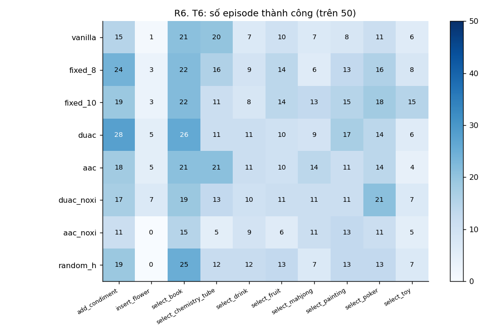 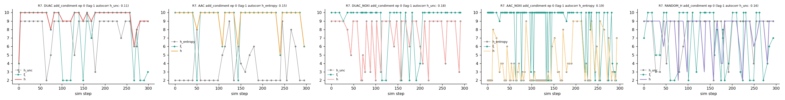 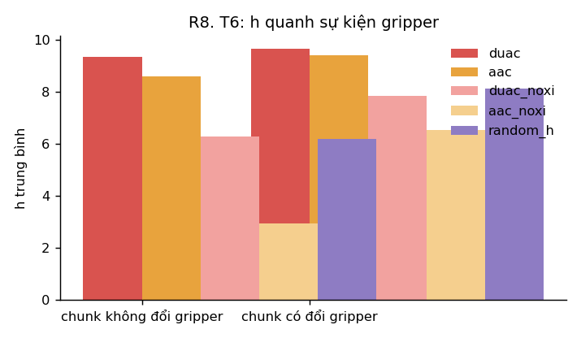

## Hạn chế

- Tham chiếu chính thức là vanilla trên 50 episode; các arm khác chưa có số chính thức.
- α = 3 lấy theo LIBERO (ξ đổi sang đơn vị LIBERO); chưa có ablation bỏ ξ, nên chưa tách được đóng góp riêng của phần bất định.
- Thời gian trong `decisions.csv` có lẫn thời gian chờ khi nhiều client chung một server; chi phí so sánh dùng số đo sạch.
- Episode lỗi mô phỏng (PhysicsError) được tính là thất bại; evaluator chính thức bỏ chúng khỏi trung bình.
